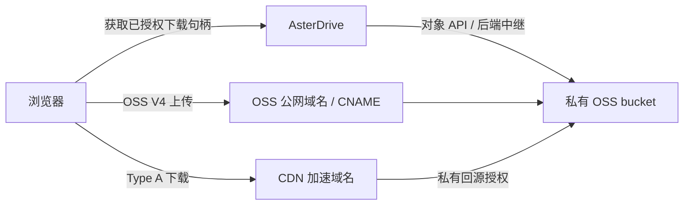

:::tip[这一篇覆盖什么]
这页讲怎样把 AsterDrive 文件写入阿里云对象存储 OSS。AsterDrive 使用原生 `OSS4-HMAC-SHA256` 签名，不把 OSS 原生策略伪装成普通 S3-compatible 配置。
:::

## 什么时候选阿里云 OSS

- 已经有阿里云 OSS bucket，希望保留 OSS 原生 endpoint 和 region 语义
- AsterDrive 服务端可以走 OSS 内网 endpoint，但浏览器直传仍要走公网 endpoint
- bucket 绑定了自定义域名，需要 CNAME 访问
- 需要 `relay_stream` 与 `presigned` 上传、下载和 multipart 上传

只接通一个“看起来像 S3”的 endpoint 不等于原生 OSS 支持。OSS V4 的算法、credential scope、canonical URI 和 query 参数都与 AWS SigV4 不同。

## 入口速查

| 任务 | 位置 |
| --- | --- |
| 创建 bucket、AccessKey、CORS | 阿里云 OSS 控制台 |
| 创建策略 | `管理 -> 存储策略 -> 新建策略 -> 阿里云 OSS` |
| 分配给用户或团队 | `管理 -> 策略组` |
| 对比 `relay_stream` / `presigned` | [存储能力矩阵](/reference/storage-matrix/) |

## 1. 准备 OSS bucket

1. 创建专用 bucket，记录 bucket 名称和 region，例如 `cn-hangzhou`
2. 记录公网 endpoint，例如 `https://oss-cn-hangzhou.aliyuncs.com`
3. 如果 AsterDrive 与 OSS 在同一云网络，记录可供服务端使用的内网 endpoint，例如 `https://oss-cn-hangzhou-internal.aliyuncs.com`
4. 创建只允许访问该 bucket 的 AccessKey，至少授予对象读、写、删除、列举和 multipart 所需权限
5. 如果使用 `presigned`，为 AsterDrive 站点配置 OSS CORS

:::caution[Alibaba Cloud 国际站账号]
[阿里云中国站文档](https://help.aliyun.com/zh/oss/user-guide/regions-and-endpoints)仍将 `oss-cn-<region>.aliyuncs.com` 列为中国内地地域的外网 endpoint，上面的默认配置适用于中国站账号。Alibaba Cloud 国际站则[另行规定](https://www.alibabacloud.com/zh/notice/oss_update_notice_policy_change_in_calling_data_api_operations_via_the_default_public_domain_name_45a)：在 2025 年 3 月 20 日 00:00:00（UTC+8）之后激活 OSS 的国际站用户，不能通过默认公网域名调用中国内地地域 bucket 的数据 API；此前已激活的国际站用户和内网域名不受影响。若请求返回 `PublicEndpointForbidden`（HTTP 400，EC `0048-00000401`），请给 bucket [绑定自定义域名](https://help.aliyun.com/zh/oss/user-guide/map-custom-domain-names-5)，启用 **使用自定义域名（CNAME）**，再把该域名配置为公网 endpoint。浏览器 presigned 上传和下载也需要使用该 CNAME 域名。
:::

不要把 AccessKey 写入日志、截图或 issue。AsterDrive 会把 connector credential 加密存储，备份和迁移时必须同时保留 `[auth].storage_credential_secret_key`。

## 2. 理解三个 endpoint 相关字段

| 字段 | 作用 |
| --- | --- |
| 公网 endpoint | 生成浏览器可见的 presigned URL；没有服务端 endpoint 时也用于后端 I/O |
| 服务端 endpoint | 可选，只用于 AsterDrive 后端请求；不会出现在浏览器 presigned URL 中 |
| 使用自定义域名（CNAME） | 把公网 endpoint 视为已绑定当前 bucket 的自定义域名 |

普通模式的 endpoint 必须使用 `aliyuncs.com` OSS 域名。CNAME 模式的公网 endpoint 必须是自定义域名；bucket 仍参与 OSS V4 canonical URI，但不会重复出现在实际 URL path 中。

:::caution[CNAME 不会替代服务端 endpoint]
配置了服务端 endpoint 时，后端 I/O 使用服务端 endpoint，浏览器 presigned URL 仍使用公网 endpoint。先分别确认服务端和浏览器的 DNS、HTTPS 与网络可达性。
:::

### CNAME 配置示例

先在 OSS 控制台为目标 bucket 绑定自定义域名，按控制台要求完成域名所有权验证和 DNS CNAME 记录，并配置覆盖该域名的 HTTPS 证书。应绑定对象 API 的访问域名，不要使用静态网站托管地址。

| 配置 | 示例 |
| --- | --- |
| Bucket | `asterdrive-test-bucket` |
| Region | `cn-hangzhou` |
| 公网 endpoint | `https://files.example.com` |
| 使用自定义域名（CNAME） | 开启 |
| 服务端 endpoint | 可选 `https://oss-cn-hangzhou-internal.aliyuncs.com`，仅填写后端实际可达的 OSS 官方域名 |
| 基础路径 | `prod/`，不要写进 endpoint |

浏览器对象 URL 应类似 `https://files.example.com/prod/对象键`，不应出现 `/asterdrive-test-bucket/`。CNAME 是 OSS API 的别名，不代表开启 CDN；只给 CDN 用的域名放在 **下载交付地址** 字段。先验收 CNAME 的 presigned PUT、multipart 和 GET，再叠加 CDN，避免把两条链路的问题混在一起。

## 2.1 可选：CDN 下载交付

AsterDrive 仅支持阿里云 CDN 的 **Type A URL 鉴权**。默认选择 **OSS 源站直连（OSS V4）**。将 **下载交付方式**改为 **阿里云 CDN 加速下载（Type A）**后，才展示 CDN 域名、有效时长和密钥；选择 CDN 时域名与密钥必填。CDN 密钥与 OSS AccessKey 分别配置：OSS V4 用于对象 API 和 CNAME，Type A 用于 CDN 下载。上传、删除、列表、multipart、清理及服务端中继仍使用 OSS API endpoint。

| 字段 | 用途 |
| --- | --- |
| 下载交付方式 `download_delivery` | 默认 `oss_origin`；CDN 选择 `alibaba_cdn_type_a` |
| 下载交付地址 `download_base_url` | CDN 模式必填的 HTTPS 加速域名，例如 `https://cdn.example.com`；不允许凭证、query、fragment 或路径 |
| CDN 鉴权有效时长（秒） | 必须与 CDN 控制台的“鉴权 URL 有效时长”一致；默认 300 秒，范围 1–31536000 秒 |
| CDN 鉴权密钥 | 配置 CDN 域名时必填；使用 Type A 的主 KEY 或备 KEY，6–128 位英文字母或数字，加密保存 |

先区分两条路径：



**普通“测试连接”验证的是 OSS endpoint**，不会读取或修改 CDN 控制台，也不能证明 Type A、CDN CORS 或缓存鉴权已经生效。

配置步骤：

1. 在阿里云 CDN 控制台添加加速域名，源站选择当前 OSS bucket，并配置 HTTPS
2. 在 **CDN 控制台 -> 目标域名 -> 回源配置 -> 阿里云 OSS 私有 Bucket 回源**开启私有回源，同账号选择“同账号回源”并完成页面要求的授权；源站类型选择 **OSS 域名**，回源 Host 指向目标 Bucket 域名。另在访问控制中开启 **Type A URL 鉴权**并记录主 KEY 或备 KEY
3. 将控制台的“鉴权 URL 有效时长”和 AsterDrive 的 **CDN 鉴权有效时长（秒）**设为相同值，例如都设为 300 秒。在 CDN 的 **域名管理 -> 目标域名 -> 访问控制 -> URL 鉴权**中配置，并确保鉴权覆盖全部路径和文件；AsterDrive 对象键可能没有文件扩展名
4. 在 AsterDrive 中将下载方式设为 `presigned`，下载交付方式选择 **阿里云 CDN 加速下载（Type A）**，再填写显示出的下载交付地址、鉴权密钥和有效时长
5. 为 CDN 域名配置允许 AsterDrive 站点来源的 CORS，确保浏览器可以执行 GET 和 Range 下载；不要只配置 OSS bucket 的 CORS
6. 保持对象路径大小写和编码语义，不做路径重写。Type A 验签后会剥离鉴权参数再使用对象缓存；缓存键忽略 query 不等于回源移除 query，应限制非预期业务参数，避免未签名的 `response-*` 改变源站响应
7. 检查客户端响应的浏览器缓存策略，例如 `Cache-Control: private, no-store`；需要边缘缓存时单独配置和验证 CDN 节点缓存规则，避免浏览器缓存被误当作鉴权期限

:::caution[用户鉴权与回源授权分别配置]
私有 OSS bucket 的回源授权不能代替 CDN 用户鉴权。CDN 控制台必须开启 Type A；选择 CDN 交付但域名或密钥不完整时，AsterDrive 拒绝保存策略。更改有效时长时必须同步两侧，AsterDrive 无法自动读取控制台配置。
:::

### 链接有效期与缓存时间

[Type A](https://help.aliyun.com/zh/cdn/user-guide/type-a-signing) 使用 `auth_key=timestamp-rand-uid-md5hash`，签名基于编码后的对象路径。CDN 的失效时间是 `timestamp + 控制台鉴权有效时长`。AsterDrive 会将链接时长限制为调用方请求时长与配置有效时长的较小值，并在请求较短时回拨签名时间戳，因此返回的 `expires_at` 与实际失效时间一致，而不是把两个时长相加。

**鉴权有效期不等于 CDN 缓存时间。** 边缘节点的缓存保留由 CDN 缓存规则及源站响应头决定；即使对象仍在缓存中，过期或被篡改的鉴权链接也应返回 403。泄露的链接在有效期内仍可被持有者使用，紧急撤销需轮换 CDN 密钥。

以配置 300 秒为例：调用方请求 300 秒时，链接时间戳为当前时间；请求 60 秒时，时间戳回拨 240 秒，CDN 在当前时间后 60 秒过期。**不能在 URL 的时间戳中直接填写当前时间加 300 秒**，否则 CDN 还会再加一次控制台时长。

### CDN CORS 检查表

| 设置 | 建议检查 |
| --- | --- |
| 允许来源 | AsterDrive 的完整 origin，例如 `https://drive.example.com`；不包含路径 |
| 允许方法 | GET、HEAD；实际 Range 请求及其 preflight 应能通过 |
| 允许请求头 | 放行实际使用的 `Range` 等请求头，不要求附带 AsterDrive Cookie |
| 暴露响应头 | 按下载流程需要暴露 `Content-Length`、`Content-Range`、`Accept-Ranges`、`ETag` |
| HTTPS | 直接访问有效 HTTPS 地址，证书覆盖域名，不依赖跨域重定向修正 HTTP 地址 |

服务端 `curl` 请求成功不能证明浏览器 CORS 已通过，应同时检查浏览器 Network 面板及控制台。签名 URL 是临时访问凭证，不截图或公开完整 query。

### 哪些请求使用 CDN

- 已授权的浏览器 Blob 下载和安全预览可以使用 CDN。前端以当前文件名写入本地文件，并使用资源句柄中的 MIME 信息
- 普通直开链接、外部查看器及要求严格响应头的附件路由使用同源中继；HTML 等需要隔离的内联预览仍保留安全边界
- Type A 不签署任意业务 query。AsterDrive 不向 CDN URL 追加未认证的 `response-*` 参数，不依赖这些参数控制文件名或内容类型
- 选择 **OSS 源站直连（OSS V4）** 时，`presigned` 下载使用 OSS 公网 endpoint 或 CNAME；隐藏的 CDN 配置不会自动启用 CDN

### 单独验收 CNAME 与 CDN

用专用测试文件检查以下路径：

1. CNAME 模式的 presigned PUT 和 multipart part URL 使用 OSS 自定义域名及 `x-oss-signature`，URL path 不重复 bucket，也不出现 CDN 域名
2. 浏览器 Blob 下载和图片预览使用 CDN 域名及 `auth_key`，保留基础路径；重命名文件后保存到本地仍使用当前文件名
3. CDN Range 下载返回正确字节；需要 Range 响应头时检查 CORS 暴露配置
4. 有效签名可读；修改路径、摘要或时间戳，以及等待链接过期后，均应被 CDN 拒绝；缓存命中也不能绕过鉴权
5. 直开、外部查看及需要安全隔离的内联预览保持中继，不丢失附件下载、文件名或 MIME 语义

真实 OSS CNAME、CDN 边缘鉴权、CORS 和缓存行为须由具备阿里云资源的管理员验收；本地测试不代表实机通过。

无签名、错误密钥、路径/时间戳/摘要被修改和过期链接都需要测试。对未缓存对象先测试一次，再用有效链接填充缓存后重复负向测试；缓存命中不能让无效链接恢复可读。轮换密钥时同步两侧并检查旧链接；只更改分享权限不会即时撤销已经签发的 CDN 链接。

参考阿里云官方[配置 URL 鉴权](https://help.aliyun.com/zh/cdn/user-guide/configure-url-signing)和[鉴权方式 A](https://help.aliyun.com/zh/cdn/user-guide/type-a-signing)。

## 3. 创建 AsterDrive 存储策略

在 `管理 -> 存储策略` 新建 **阿里云 OSS**，填写：

- 公网 endpoint
- 可选服务端 endpoint
- OSS region
- bucket
- 可选基础路径
- 是否使用 CNAME
- 下载交付方式；仅在选择 CDN 时填写 CDN 域名、鉴权有效时长和鉴权密钥
- AccessKey ID / AccessKey Secret
- 上传方式和下载方式

先使用 `relay_stream` 完成连接测试和端到端验收。确认服务端读写、Range、删除、复制和 multipart 稳定后，再切 `presigned`。配置 下载交付地址时，单独验收 CDN 下载链路。

## 4. 为 presigned 配置 CORS

浏览器直接访问 OSS 的当前链路使用 `PUT` 上传对象或分片，使用 `GET`、`HEAD` 下载或读取对象；分片发起、完成、取消等管理请求由 AsterDrive 后端处理。CORS 需要允许实际上传携带的 `Content-Type`、下载使用的 `Range`，并暴露分片完成必需的 `ETag` 及下载读取的 `Content-Length`、`Content-Range`、`Accept-Ranges`、`Content-Disposition`。单文件 presigned PUT 会由服务端在 complete 阶段校验对象 metadata 和大小，因此不要求浏览器读取 `ETag`；分片上传必须读取每个 part 的 `ETag`。

### 用 AsterDrive 自动配置

在 `管理 -> 系统设置 -> 站点配置` 设置有效的**公开站点地址**后，打开阿里云 OSS 存储策略，点击 **配置 CORS** 并使用通用远端状态变更确认框确认。新策略草稿、编辑草稿和已保存策略均可执行；编辑时 AK/SK 留空会复用该策略已保存的凭据，动作始终使用当前表单的 bucket 和 endpoint。普通保存与测试连接不会配置 CORS。

动作先读取 bucket 原有规则，再追加本站所需规则；完整等价规则不会重复写入。它保留已有规则与顺序，不按 Origin 猜测规则归属或删除旧规则。如果公开站点地址改变，旧 Origin 对应规则可能仍在 bucket 中，管理员须在 OSS 控制台审查并清理。读取失败、无法无损保留的未知字段、超过 20 条规则或 16 KB XML 时不会覆盖配置。执行期间避免在控制台或其他实例同时修改同一 bucket 的 CORS；OSS 整份覆盖接口不能保证外部并发编辑不丢失。

执行凭据需要目标 bucket 的 `oss:GetBucketCors` 与 `oss:PutBucketCors` 权限；权限拒绝时结果仅显示脱敏 provider code 和所需权限。动作只修改 OSS **bucket** CORS，不更改 bucket policy、公开访问、CDN 或防盗链。OSS 源站、独立上传域和 CDN/自定义下载域的浏览器 CORS 要分别验收；写入成功不等于这些路径都已可用。参见阿里云 [GetBucketCors](https://help.aliyun.com/zh/oss/developer-reference/getbucketcors) 与 [PutBucketCors](https://help.aliyun.com/zh/oss/developer-reference/putbucketcors)。

如果连接测试通过但浏览器直传失败，优先检查：

1. 浏览器拿到的 URL 是否使用公网 endpoint 或 CNAME，而不是内网 endpoint
2. CORS `AllowedOrigin` 是否与浏览器地址栏的 origin 完全一致
3. multipart part 响应的 `ETag` 是否对浏览器可见
4. 自定义域名 HTTPS 证书是否覆盖当前域名

## 5. 创建测试策略组并绑定用户或团队

不要一开始就修改默认策略组。先创建一条独立的 OSS 测试策略，进入：

```text
管理 -> 策略组
```

新建“OSS 测试组”，添加规则指向刚创建的 OSS 策略；先让规则覆盖测试文件的全部大小范围，并确认优先级不会被其他规则抢先匹配。

- 个人空间：在 `管理 -> 用户 -> 用户详情` 将测试用户绑定到“OSS 测试组”
- 团队空间：在 `管理 -> 团队 -> 团队详情` 绑定测试团队；团队上传使用团队策略组，不使用个人用户策略组

存储策略负责“写到哪里”，策略组规则负责“这次上传选哪条策略”，绑定决定“哪个用户或团队应用这组规则”。只创建存储策略不会自动接管所有上传。

## 6. 分阶段实际验收

| 阶段 | 操作 | 观察结果 |
| --- | --- | --- |
| OSS 中继 | 上传小文件，下载后比对内容，删除并恢复 | 数据与文件记录一致，对象位于预期 bucket / 基础路径 |
| multipart | 上传大文件，暂停后续传，再单独测试取消 | 分片及完成状态正确，取消不会留下仍可完成的会话 |
| CNAME 直传 | 切换上传为 `presigned`，测试单文件和 multipart | 浏览器使用 CNAME、公网可达，分片 ETag 能被读取 |
| OSS 直连下载 | 不配置 CDN，下载方式为 `presigned` | 使用 OSS V4，文件名、Range、PDF/视频 seek 正确 |
| CDN 下载 | 配置 Type A，执行上面的 CDN 专项验收 | Blob 下载/安全预览走 CDN，负向鉴权与缓存命中均符合预期 |
| 文件与分享 | 复制、移动、重命名、覆盖冲突、公开分享下载 | 文件归属、权限及当前文件名正确，严格请求保持中继 |

同时检查 AsterDrive 后台任务、浏览器 Network/CORS 错误和 OSS/CDN 侧错误。连接测试成功只覆盖 endpoint 与读写凭据，不能代替上述流程。暂未执行的实机项保留为待验收，不用本地签名测试代替。

## 7. 切换正式流量

测试策略组通过后，再调整真实用户或团队的绑定。已有文件需要迁移时，新建目标策略并使用 `管理 -> 存储策略 -> 迁移数据`，完成迁移与下载复核后再切换规则。

:::caution[不要直接重新定位已有策略]
不要直接修改已有策略的 bucket、endpoint、region、CNAME 或基础路径。这些字段共同决定旧对象位置及签名方式；控制台手动移动、改名或删除 blob 对象也会破坏数据库与存储的一致性。
:::

## 常见问题

### `SignatureDoesNotMatch`

确认 region 与 bucket endpoint 匹配，AccessKey 没有多余空白，系统时间准确，并且没有把 OSS 原生策略填进通用 S3 connector。

### 服务端正常，浏览器 presigned URL 访问失败

服务端 endpoint 只证明 AsterDrive 后端可达。检查公网 endpoint / CNAME、HTTPS、DNS 和 CORS。

### CNAME URL 里又出现了 bucket

确认启用了 **使用 CNAME 自定义域名**，且公网 endpoint 填的是绑定到 bucket 的自定义域名，而不是 `aliyuncs.com` provider endpoint。

### CDN 下载返回 403

先看错误由谁返回：

- 返回 OSS XML，包含 `AccessDenied`、`You have no right to access this object because of bucket acl.`、OSS `HostId` 或 `EC=0003-00000001`：优先排查 **CDN 到 OSS 的私有回源授权**、回源 Host 和 Bucket Policy，不能靠修改 Type A 密钥解决，也不要把 bucket 改成公有读
- 同账号回源：在上面的 CDN 私有 Bucket 回源入口开启并完成授权；CDN 不会自动继承 AsterDrive 保存的 OSS AccessKey
- 跨账号或 RAM AccessKey 回源：先给回源身份授予目标 Bucket 所需权限，再配置 CDN 私有回源。官方错误码说明指出，顺序错误可能导致 CDN 无法把 STS 鉴权配置下发到节点
- 完成授权后重新获取签名链接，用未缓存的测试对象检查回源；已有负缓存时刷新对应对象缓存。仅见到 OSS 错误不能作为 Type A 用户鉴权已通过的完整证据

依据：[CDN 加速 OSS 的私有回源步骤](https://help.aliyun.com/zh/oss/user-guide/use-cdn-to-accelerate-access-to-oss)及[错误码 0003-00000001](https://help.aliyun.com/zh/oss/support/0003-00000001)。

确认 CDN 控制台启用了 Type A、两侧鉴权密钥及“鉴权 URL 有效时长”一致，并检查系统时间、对象路径编码及链接是否过期。不要在日志或问题报告中粘贴密钥或完整签名 URL。

### 配置了 CDN，下载却仍走 AsterDrive

先确认策略下载方式为 `presigned`、下载交付方式为 **阿里云 CDN 加速下载（Type A）**，测试用户/团队确实使用该策略，且请求的是允许源站响应头的 Blob 下载或安全预览。普通直开、外部查看器、精确附件响应和需要隔离的内联预览使用中继是预期行为；浏览器不支持流式保存文件时也会走已有附件下载路径。

### 服务端能读取 CDN，浏览器失败

检查 CDN 域名自身的 CORS、证书和实际访问来源，尤其不要只检查 OSS bucket 的 CORS。浏览器请求不应携带 AsterDrive Cookie 或自行添加条件请求头。
