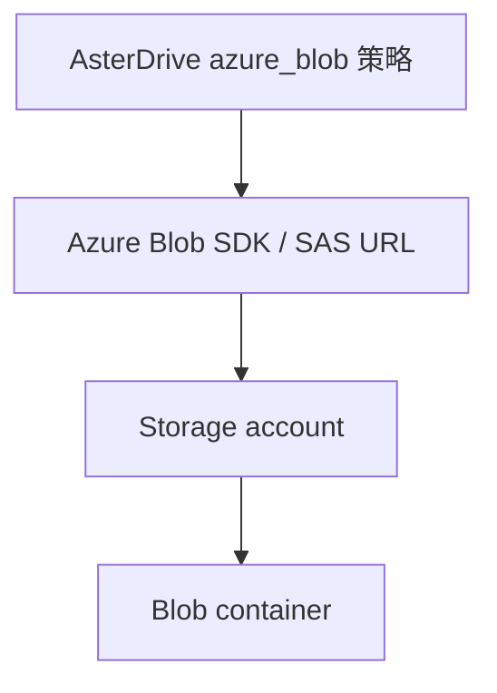
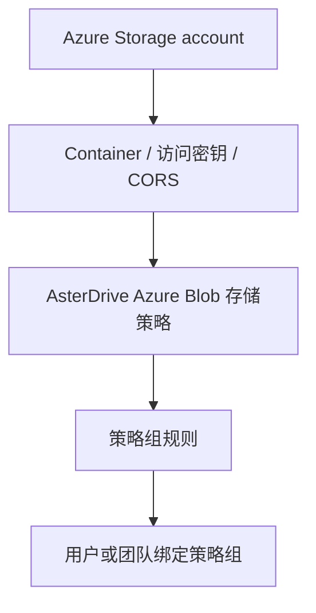
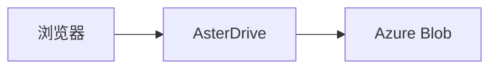
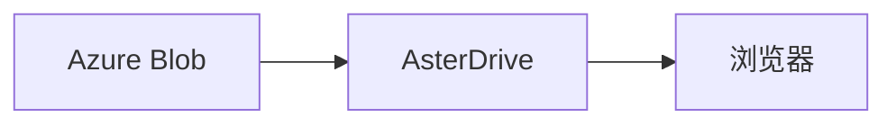
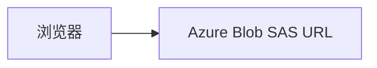

:::tip[这一篇覆盖什么]
这一篇按完整流程讲怎么把 AsterDrive 文件写到 Azure Blob Storage：准备 storage account 和 container、创建 `azure_blob` 存储策略、配置策略组规则、绑定用户或团队、验收上传下载，并说明怎么选择服务端中继或浏览器直传。
:::

## 适合什么时候用

Azure Blob Storage 适合这些场景：

- 你已经在 Azure 上使用 Storage account 和 Blob container
- 希望把文件容量、对象持久化和下载带宽交给 Azure 承接
- 希望 AsterDrive 使用 Azure 官方 Blob SDK 访问对象，而不是把 Azure 当 S3-compatible 存储

如果你用的是 S3、MinIO、R2 或其他 S3-compatible 服务，看 [S3 / MinIO / R2 存储策略教程](/admin/storage-backends/s3/)。如果你用腾讯云 COS，并且要接数据万象能力，看 [腾讯云 COS 存储策略教程](/admin/storage-backends/tencent-cos/)。

## Azure Blob 和 S3-compatible 的区别

AsterDrive 里 `azure_blob` 是独立存储后端，不走 S3 兼容接口。



几个名字不要混：

| AsterDrive 字段 | Azure 里的概念 | 说明 |
| --- | --- | --- |
| Endpoint | Blob service endpoint | 例如 `https://<account>.blob.core.windows.net` |
| Bucket / 容器 | Container | Azure 叫 container，不叫 bucket |
| Access Key / 存储账户名 | Storage account name | 不是 Access Key ID |
| Secret Key / 存储账户密钥 | Storage account key | 用于服务端签名 SAS |
| 基础路径 | Blob name prefix | 可选，用于把对象放到某个前缀下 |

## 先分清你要配哪几层



只创建 Azure Blob 存储策略还不够。用户或团队上传时，会先命中策略组，再由策略组规则分配到某条存储策略。

## 这篇用到的入口

| 你要做什么 | 入口 |
| --- | --- |
| 创建 Azure Blob 策略 | `管理 -> 存储策略 -> 新建策略` |
| 测试 Azure Blob 连接 | `管理 -> 存储策略 -> 测试连接` |
| 创建分流规则 | `管理 -> 策略组` |
| 给用户绑定策略组 | `管理 -> 用户 -> 用户详情` |
| 给团队绑定策略组 | `管理 -> 团队 -> 团队详情` |
| 调公开站点地址 | `管理 -> 系统设置 -> 站点配置 -> 公开站点地址` |

## 1. 准备 Storage account 和 container

先在 Azure 创建或选择一个 Storage account，例如：

```text
asterdriveprod
```

再创建一个专用 container，例如：

```text
asterdrive-prod
```

建议给 AsterDrive 单独规划 prefix：

```text
prod/
```

这样对象最终会在 container 里按 AsterDrive 的内容寻址路径继续展开。不要让多个 AsterDrive 实例写同一个 prefix，除非你明确知道它们不会互相覆盖或清理对象。

:::caution[不建议人工移动 container 里的 blob]
AsterDrive 数据库记录了对象路径。人工移动、重命名或删除 Azure Blob 里的对象，会让数据库里的文件记录和真实对象不一致。
:::

## 2. 准备访问凭证

AsterDrive 当前使用 Storage account name 和 account key 访问 Azure Blob。

在 Azure Portal 里找到：

```text
Storage account -> Security + networking -> Access keys
```

准备这些值：

| 值 | 填到 AsterDrive |
| --- | --- |
| Storage account name | `Access Key / 存储账户名` |
| key1 或 key2 | `Secret Key / 存储账户密钥` |
| Blob service endpoint | `Endpoint` |
| Container name | `Bucket / 容器` |

如果你的组织使用更细的密钥轮换流程，可以先用 `key2` 配新策略，验证通过后再切换策略组。不要在有活动上传时直接改正在使用策略的 endpoint、container 或基础路径。

## 3. 先选上传和下载方式

第一次接入建议先用保守路线：

| 方向 | 建议初始值 | 原因 |
| --- | --- | --- |
| 上传方式 | `relay_stream` | 浏览器不需要直连 Azure Blob，少踩 CORS |
| 下载方式 | `relay_stream` | 下载也先由 AsterDrive 中继，便于排查 |

确认基本读写没问题后，再考虑切换到：

- 上传 `presigned`
- 下载 `presigned`

### `relay_stream` 怎么工作

上传时：



下载时：



好处是入口集中，排查简单。代价是应用节点要承接上传和下载带宽。

### `presigned` 怎么工作

Azure Blob 下的 `presigned` 使用 Azure SAS URL，不是 S3 presigned URL。

上传时：



下载时：


好处是减轻 AsterDrive 节点带宽压力。前提是浏览器能访问 Azure Blob endpoint，并且 Blob service CORS 配置正确。

预签名下载使用 AsterDrive 当前文件名和 MIME，并应用下载缓存策略。即使对象在 Azure 中以 UUID 命名，或文件在 AsterDrive 中重命名，重新发起下载也会使用当前文件名，无需移动 Azure 对象。已有 SAS URL 在到期前仍保留签发时的名称。

这些响应头由 AsterDrive 生成 SAS 时设置。CORS 的 `Exposed headers` 只控制脚本能否读取已有响应头，不负责设置下载文件名。

## 4. 在 AsterDrive 创建 Azure Blob 存储策略

进入：

```text
管理 -> 存储策略 -> 新建策略
```

选择驱动类型：

```text
Azure Blob
```

按下面填写：

| 字段 | 示例 | 说明 |
| --- | --- | --- |
| Endpoint | `https://asterdriveprod.blob.core.windows.net` | Blob service endpoint，末尾 `/` 会自动规整 |
| Bucket / 容器 | `asterdrive-prod` | Azure container name |
| Access Key / 存储账户名 | `asterdriveprod` | Storage account name，保存前会 trim |
| Secret Key / 存储账户密钥 | `...` | Storage account key，保存前会 trim |
| 基础路径 | `prod/` | 可选，作为 blob name prefix |
| 上传方式 | 初次建议 `relay_stream` | 稳定后再切 `presigned` |
| 下载方式 | 初次建议 `relay_stream` | 稳定后再切 `presigned` |

:::caution[Endpoint 要写 Blob service endpoint]
不要把 Azure Portal 首页 URL、container URL 或 SAS URL 填进 Endpoint。Endpoint 应该类似 `https://<account>.blob.core.windows.net`。Container 单独填到“Bucket / 容器”字段。
:::

## 5. 保存前先测试连接

保存前或保存后，先用后台的连接测试确认：

- AsterDrive 能访问 endpoint
- container 存在
- account name 和 key 能完成签名和对象操作
- 基础路径没有填错
- 如果使用 `presigned`，浏览器也能访问这个 endpoint

编辑已有策略时，如果存储账户名或账户密钥字段留空，草稿连接测试会复用这条策略已经保存的凭据。这样你可以先测试 endpoint、container、基础路径、上传方式等变更，不必每次重新粘贴 account key。新建策略没有可复用凭据，仍然必须填完整。

连接测试失败时，后台会显示可用于排查的原因，并隐藏账户密钥等敏感信息。

如果连接测试失败，不要继续把用户切到这条策略。先按下面顺序查：

1. Endpoint 是否包含 `http://` 或 `https://`
2. Endpoint 是否是 Blob service endpoint
3. Container 名是否正确
4. Storage account name 是否正确
5. Storage account key 是否复制完整
6. AsterDrive 服务器时间是否准确
7. 服务器网络是否能访问 Azure Blob endpoint
8. 如果是私有网络、专线或防火墙，是否允许 AsterDrive 所在网络访问

## 6. 配置 CORS

如果只使用 `relay_stream`，浏览器不直接请求 Azure Blob，无需为此配置源站 CORS。浏览器 `presigned` 上传、分块上传、下载及 Blob 预览则需要允许站点来源。

### 自动配置

1. 在 `管理 -> 系统设置 -> 站点配置 -> 公开站点地址` 配置实际浏览器站点 Origin，例如 `https://drive.example.com`，可以配置多个明确来源。来源按浏览器 Origin 规则规范化，省略 HTTP 的默认端口 `80` 和 HTTPS 的默认端口 `443`，并合并重复来源。
2. 在 Azure Blob 策略的新建或编辑表单中填写当前连接，点击 **自动配置 Azure Blob CORS**。编辑时留空的凭据复用该策略已保存的值，新建策略必须填写完整凭据。
3. 核对当前账户、endpoint 和账户级影响范围，使用与 COS 相同的动作确认流程。点击动作打开确认区，确认后由后端读取当前连接与公开站点 Origin 并配置 CORS。
4. 查看结果中的配置变更状态、保留规则数和 Azure 请求 ID，然后继续浏览器验收。

:::caution[影响账户的所有 Blob 容器]
CORS 配置属于当前使用的整个存储账户的 Blob Service，影响该账户的所有容器。多个应用共用账户时，请先确认这一影响范围。
:::

动作使用账户的主 Blob service endpoint（Azure 公有云、中国云、美国政府云及德国云官方域名），使用当前 storage account name + account key 进行 Shared Key 认证。管理请求发送到账户 Blob Service 根路径；本地 Azurite 的 loopback endpoint 可用于协议测试。自定义源站域名、Private Link 专用域名或其他未识别 endpoint 请在 Azure Portal 手工配置。

该配置需要 AsterDrive 服务端有足够权限更改 Blob Service 的 CORS 配置。账户须启用 Shared Key，并在 Azure 网络规则中放行运行 AsterDrive 的服务端或其出口网络访问 Blob Service。当前动作使用账户名和账户密钥进行账户级认证。组织要求使用其他认证方式时，请通过 Azure Portal 按组织策略配置 CORS。权限失败信息包含脱敏 provider code、请求 ID 和权限排查指引。

自动配置先读取现有 CORS，完整保留规则及相对顺序，仅在没有完整等价规则时追加一条规则。完整等价比较包含 Origin、方法、请求头、暴露响应头和缓存时间，忽略列表顺序及 header 名大小写。不会仅凭本站 Origin 认领、更新或删除规则，公开站点地址变化后也不会自动清理旧规则。其他 Blob service 属性通过请求中省略对应 XML 顶层元素保留。

Azure 按规则顺序选择首次匹配 Origin 和方法的规则。如果已有规则会与所需规则重叠，自动动作会停止并提示人工处理，不会重排或改写已有规则。超过 5 条规则、所有规则值合计超过 2 KiB（不含 XML 标签）、未知 CORS 字段、读取失败或解析失败也会在写入前停止。写入后按相同规则顺序和字段语义回读验证；如果 Azure 已接受写入但回读失败，错误会明确说明配置可能已变更，并保留可用的写入请求 ID，请先检查账户配置再重试。多个管理员或外部工具并发修改 CORS 时，服务属性接口没有本动作可用的条件写入保护，请避免同时修改，并检查最终配置。

### 自动规则与手工配置

| 项 | 自动配置值 |
| --- | --- |
| Allowed origins | 规范化后的全部公开站点 Origin，明确列出，不使用 `*` |
| Allowed methods | `PUT,GET,HEAD`，覆盖单文件与 Block Blob 分块上传及读取 |
| Allowed headers | `content-type,range,x-ms-blob-type,x-ms-version` |
| Exposed headers | `ETag,Content-Length,Content-Range,Content-Disposition,Accept-Ranges,x-ms-request-id` |
| Max age | `600` 秒 |

手工配置也应按这份请求契约允许来源和 header。不要把后端内网地址当成浏览器 Origin。`Exposed headers` 让脚本读取已有响应头，不负责设置下载文件名。

源站 CORS 写入成功只证明源站配置已更新。Front Door/CDN 的响应头、OPTIONS 路由与缓存行为必须单独配置和验收，上传使用的 Blob service endpoint 和下载域名也需分别检查。

## 7. 创建测试策略组

不要一上来直接改默认策略组。建议先创建一个测试策略组。

进入：

```text
管理 -> 策略组
```

创建策略组，例如：

```text
Azure Blob Test Group
```

添加一条规则：

| 字段 | 建议 |
| --- | --- |
| 存储策略 | 刚创建的 Azure Blob 策略 |
| 优先级 | 保持默认或设为最先命中 |
| 文件大小范围 | 先覆盖所有大小，方便测试 |

## 8. 绑定测试用户或测试团队

### 绑定用户

进入：

```text
管理 -> 用户 -> 用户详情
```

把测试用户的策略组改成刚才创建的 `Azure Blob Test Group`。

### 绑定团队

进入：

```text
管理 -> 团队 -> 团队详情
```

把测试团队的策略组改成 `Azure Blob Test Group`。

团队空间上传时会按团队策略组走，不按个人用户策略组走。

## 9. 做一轮真实验收

用被绑定到测试策略组的真实账号测试：

1. 上传一个小文件
2. 上传一个超过分片阈值的大文件
3. 下载文件
4. 分享文件并访问分享链接
5. 删除文件，再从回收站恢复
6. 再删除并清理回收站，确认 Azure container 里的对象清理正常

如果你准备启用 `presigned`，再额外测试：

1. 把上传方式改成 `presigned`
2. 上传小文件和大文件
3. 确认浏览器可以直接连接 Azure Blob
4. 如果启用 `presigned` 下载，确认下载和预览都正常

## 常见问题

### 为什么后台还显示 Bucket 字段？

为了和其他对象存储保持一致，部分界面仍会显示 `Bucket`。对 Azure Blob 来说，它对应的是 **container**。

### 为什么 `presigned` 上传失败但 `relay_stream` 正常？

`relay_stream` 只要求 AsterDrive 服务器能访问 Azure Blob。`presigned` 还要求浏览器能访问 Azure Blob endpoint，并且 CORS 允许这个浏览器来源发起 `PUT` / `GET`。

优先检查：

1. 浏览器能否访问 endpoint
2. Storage account 防火墙是否允许客户端网络
3. Blob service CORS 是否包含你的 AsterDrive 公开站点 origin
4. Allowed headers 是否包含 `x-ms-blob-type`
5. SAS URL 是否还在有效期内

### 为什么生产环境要求 HTTPS？

浏览器直传地址包含短时效授权信息，生产环境应使用 HTTPS Blob service endpoint，避免上传或下载地址通过明文网络传输。

### 可以直接改已经使用中的 Azure 策略吗？

不要直接改 endpoint、container 或基础路径。这些字段决定旧文件在哪里。更稳的做法是：

1. 新建一条 Azure Blob 策略
2. 创建测试策略组验证
3. 如果要迁移已有数据，用 `管理 -> 存储策略 -> 迁移数据`
4. 完成后再调整用户或团队的策略组

## 上线检查清单

- Storage account 和 container 已准备好
- Account name 和 key 已填对，并已通过连接测试
- 基础路径规划清楚，不和其他实例混用
- 上传 / 下载方式已按网络条件选择
- 如果使用 `presigned`，Blob service CORS 已配置
- 用测试用户上传、下载、分享、删除、恢复都通过
- 大文件分片上传通过
- 生产环境使用 HTTPS endpoint
- 已确认 Azure 存储容量、请求次数和出站流量费用边界
