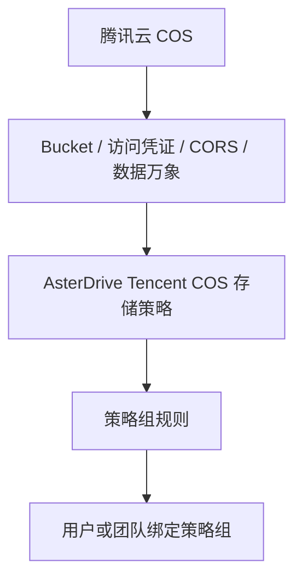
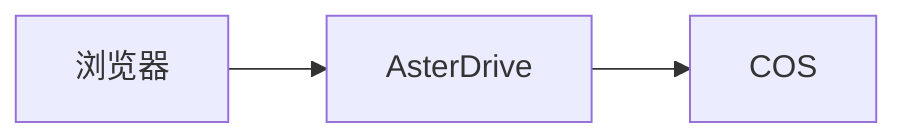
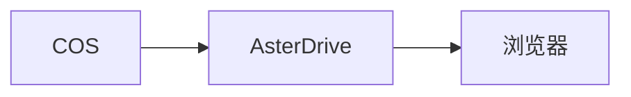
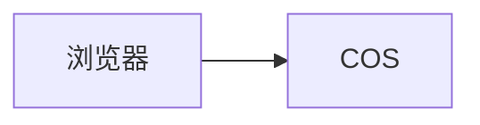
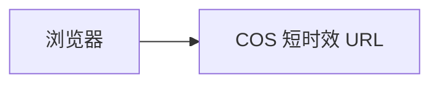

:::tip[这一篇覆盖什么]
这一篇按完整流程讲怎么把 AsterDrive 文件写到腾讯云 COS：准备 bucket、创建 `tencent_cos` 存储策略、配置策略组规则、绑定用户或团队、验收上传下载，并说明 COS 数据万象原生处理的开关、后缀和计费边界。
:::

## 适合什么时候用

腾讯云 COS 适合这些场景：

- 你已经在腾讯云上使用 COS，想让 AsterDrive 直接写入 COS bucket
- 文件较多或较大，希望把容量和带宽交给对象存储承接
- 希望按存储策略启用 COS 数据万象能力，例如图片缩略图或媒体信息解析
- 希望前端和后台明确显示“腾讯云 COS”，而不是把它混在普通 S3-compatible 后端里

如果你只需要一个通用 S3 兼容对象存储，而且不需要腾讯云数据万象能力，看 [S3 / MinIO / R2 存储策略教程](/admin/storage-backends/s3/) 更合适。

## COS 和通用 S3 存储怎么选

腾讯云 COS 支持常见的对象存储读写，也提供数据万象等腾讯云专属能力。AsterDrive 因此把它作为单独的存储类型显示。

如果要使用图片缩略图、媒体信息等腾讯云能力，创建策略时请选择 **腾讯云 COS**。只需要通用对象存储功能时，也可以参考 [S3 / MinIO / R2 存储策略教程](/admin/storage-backends/s3/)。

## 先分清你要配哪几层



只创建 COS 存储策略还不够。用户或团队上传时，会先命中策略组，再由策略组规则分配到某条存储策略。

## 这篇用到的入口

| 你要做什么 | 入口 |
| --- | --- |
| 创建 COS 策略 | `管理 -> 存储策略 -> 新建策略` |
| 测试 COS 连接 | `管理 -> 存储策略 -> 测试连接` |
| 创建分流规则 | `管理 -> 策略组` |
| 给用户绑定策略组 | `管理 -> 用户 -> 用户详情` |
| 给团队绑定策略组 | `管理 -> 团队 -> 团队详情` |
| 配置全局媒体处理 | `管理 -> 系统设置 -> 文件处理` |

## 1. 准备 bucket 和 prefix

先在腾讯云 COS 控制台创建一个专用 bucket，例如：

```text
asterdrive-prod-1250000000
```

建议给 AsterDrive 单独规划 prefix：

```text
prod/
```

这样对象最终会在 bucket 里按 AsterDrive 的内容寻址路径继续展开。不要让多个 AsterDrive 实例写同一个 prefix，除非你明确知道它们不会互相覆盖或清理对象。

:::caution[不建议人工移动 bucket 里的对象]
AsterDrive 数据库记录了对象路径。人工移动、重命名或删除 COS 里的对象，会让数据库里的文件记录和真实对象不一致。
:::

## 2. 准备访问凭证

给 AsterDrive 准备一组只用于这个 bucket / prefix 的腾讯云访问凭证。

最少需要覆盖：

- 读取对象
- 写入对象
- 删除对象
- 大文件上传所需操作
- 访问目标 bucket / prefix 的必要权限

如果你要启用 COS 数据万象，还要确认这组凭证可以发起对应 CI 处理请求，例如图片处理或媒体信息解析。权限名和控制台入口会随腾讯云产品调整，按腾讯云最新文档和控制台为准。

## 3. 先选上传和下载方式

第一次接入建议先用保守路线：

| 方向 | 建议初始值 | 原因 |
| --- | --- | --- |
| 上传方式 | `relay_stream` | 浏览器不需要直连 COS，少踩 CORS |
| 下载方式 | `relay_stream` | 下载也先由 AsterDrive 中继，便于排查 |

确认基本读写没问题后，再考虑切换到：

- 上传 `presigned`
- 下载 `presigned`

:::caution[LightCOS 只能使用服务端中继]
如果使用的是 **[轻量对象存储（Light Cloud Object Storage, LightCOS）](https://cloud.tencent.com/document/product/1722/112004)** 存储桶，请把上传和下载方式都保持为 `relay_stream`。LightCOS 没有桶级 CORS 配置入口，因此不适合浏览器 `presigned` 直传或直连下载。
:::

### `relay_stream` 怎么工作

上传时：



下载时：



好处是入口集中，排查简单。代价是应用节点要承接上传和下载带宽。

### `presigned` 怎么工作

上传时：



下载时：



好处是减轻 AsterDrive 节点带宽压力。前提是浏览器能访问 COS endpoint，并且 COS CORS 配置正确。

## 4. 配置 COS CORS

如果你只使用 `relay_stream`，浏览器不会直接请求 COS，CORS 不是第一优先级。

如果要使用 `presigned` 上传，COS bucket 需要允许浏览器跨域上传。最少关注：

- `AllowedOrigin`：你的 AsterDrive 公开站点地址
- `AllowedMethod`：包含 `PUT`
- `AllowedHeader`：允许上传请求用到的请求头
- `ExposeHeader`：使用 presigned multipart 时包含 `ETag`

单文件 presigned PUT 完成后，AsterDrive 会在服务端校验对象 metadata 和大小，不依赖浏览器读取 `ETag`。presigned multipart 完成时仍需要每个 part 的 `ETag`，所以要支持大文件直传，CORS 规则仍必须暴露 `ETag`。

如果要使用 `presigned` 下载，也要确认浏览器可以访问 COS 返回的下载地址，并且你接受下载响应头、缓存行为更多由 COS 决定。

### 用 AsterDrive 自动配置 CORS

AsterDrive 可以在管理后台为 Tencent COS 策略执行存储动作：

```text
管理 -> 存储策略 -> 目标 COS 策略 -> 配置 CORS
```

这个功能只适用于标准腾讯云 COS 存储桶，不适用于 LightCOS。

执行前，先在下面的位置填写用户实际访问 AsterDrive 的公开站点地址：

```text
管理 -> 系统设置 -> 站点配置 -> 公开站点地址
```

地址必须是完整的 HTTP(S) 站点来源，例如 `https://drive.example.com`，不要带路径、查询参数或通配符。

AsterDrive 会根据这些地址创建或更新自己的 COS CORS 规则，并保留其他已有规则。执行期间不要同时在腾讯云控制台修改同一个 bucket 的 CORS，以免互相覆盖。

用于该策略的腾讯云凭证需要有读取和修改 bucket CORS 的权限。失败时优先检查公开站点地址、Access Key / Secret Key、bucket 地域和 CORS 权限。

## 5. 在 AsterDrive 创建 Tencent COS 存储策略

进入：

```text
管理 -> 存储策略 -> 新建策略
```

选择驱动类型：

```text
腾讯云 COS
```

保存前或保存后，都建议先点一次 `测试连接`。编辑已有策略时，如果 Access Key 或 Secret Key 字段留空，草稿连接测试会复用这条策略已经保存的凭据。这样你可以先测试 endpoint、bucket、基础路径、上传方式或 COS CI 开关的变更，不必每次重新粘贴 secret。新建策略没有可复用凭据，仍然必须填完整。

连接测试失败时，后台会显示可用于排查的原因，并隐藏 Secret Key 等敏感信息。

常见字段：

| 字段 | 示例 |
| --- | --- |
| Endpoint | `https://asterdrive-prod-1250000000.cos.ap-guangzhou.myqcloud.com` |
| Bucket | `asterdrive-prod-1250000000` |
| 使用自定义域名（CNAME） | 默认关闭；使用自定义源站 Endpoint 时开启 |
| Access Key | 腾讯云访问密钥 ID |
| Secret Key | 腾讯云访问密钥 Secret |
| Prefix / 基础路径 | `prod/` |
| 下载交付地址（可选） | `https://cdn.example.com/assets` |
| 上传方式 | 初次建议 `relay_stream` |
| 下载方式 | 初次建议 `relay_stream` |

使用腾讯云控制台提供的 COS endpoint 即可，不需要把它当普通 S3 服务调整 path-style。

### 自定义源站域名

先按腾讯云的[开启自定义源站域名](https://cloud.tencent.com/document/product/436/36638)指引，将域名绑定到目标 bucket 的默认源站或已启用的全球加速源站，配置 CNAME 和 HTTPS 证书。静态网站源站不适合作为对象 API endpoint。域名和证书变更通常需要约 30 分钟生效，以实际访问结果为准。

在 AsterDrive 开启 **使用自定义域名（CNAME）**，Endpoint 填写例如 `https://files.example.com`，Bucket 仍填写 `asterdrive-prod-1250000000`。读写、分片、预签名、COS 数据万象和 CORS 都通过这个域名请求，URL 不会再添加 bucket。Endpoint 只填写协议和域名（可带端口），对象前缀填写基础路径；不要附带路径、账号密码、query 或 fragment。官方域名的旧配置无需调整。

腾讯云[设置访问域名](https://cloud.tencent.com/document/product/436/55437)中的 `Domain` 同样用于 bucket 和对象 API；[预签名文档](https://cloud.tencent.com/document/product/436/36121)要求签入实际请求 Host。请直接使用 HTTPS 地址，避免“强制 HTTPS”的 302 重定向；COS 原生请求不会跟随重定向。AsterDrive 不额外要求查询域名绑定的控制面权限，请通过连接测试验证读写，再分别验证浏览器预签名、COS CI 和 CORS；这些能力依赖实际源站配置。自定义源站故障时不会自动回退到其他域名。

仅用于 CDN 下载的域名仍填写下面的下载交付地址；CDN 域名不应当作完整对象 API endpoint。

### 下载交付地址

如果 bucket 已经通过自定义源站域、CDN 或部署方反向代理暴露相同对象 key，可以填写可选的 **下载交付地址**。该地址只用于启用直连下载后的浏览器请求；AsterDrive 会把基础路径和对象路径追加到地址的 path prefix，并针对最终域名生成 COS Q-Sign。后端读写、上传、清理、CORS 和 bucket 管理仍使用上面配置的 Endpoint。

下载交付地址必须是带 DNS 主机名的 HTTPS URL，可以包含固定 path prefix，但不能包含账号密码、非默认端口、query、fragment、反斜杠或路径穿越段。连接测试只证明所配置的 COS Endpoint 可用；启用前还要实际验证交付域能访问私有对象、Range 下载和响应头覆盖。

### 腾讯 CDN 私有下载鉴权

在下载方式选择「Presigned 直连下载」，将「下载交付方式」设为 **腾讯 CDN 加速下载（Type D + SHA-256）**。上传、后端读取、multipart、清理、CORS 管理仍使用 Endpoint，CDN 只作为下载交付入口；CNAME 开关与 CDN 下载是独立配置。

| AsterDrive 字段 | 配置 |
| --- | --- |
| 下载交付地址 `download_base_url` | 必填 HTTPS CDN 地址，可带固定 path prefix；会追加策略基础路径及对象 key |
| 腾讯 CDN 鉴权密钥 `tencent_cdn_auth_key` | 与 COS SecretKey 独立的 6–32 位英文字母或数字；加密存储，编辑时留空保留旧值 |
| CDN 鉴权有效期 `cdn_auth_validity_seconds` | 1–3600 秒，默认 300，必须与云端 Type D 有效时长一致 |

在腾讯云配置以下内容后再对用户启用：

1. 使用私有读 COS 桶作为源站，授权 CDN 服务并开启回源鉴权。COS 源的回源 Host 固定为存储桶访问域名；不要把桶改为公有读。
2. CDN 访问控制开启 **Type D / SHA-256**，签名参数为 `sign`，时间戳参数为 `t`，时间格式为十进制 Unix 秒，密钥和有效时长与 AsterDrive 一致。对**全部文件和路径**鉴权，对象 key 可能没有扩展名；不要只保护 jpg/mp4 等后缀。
3. 配置 CDN HTTPS、浏览器 CORS（允许实际站点的 GET/HEAD/Range，按需暴露 Content-Length、Content-Range、Accept-Ranges、ETag）。签名 URL 不携带 AsterDrive Cookie。
4. 保持对象路径大小写敏感且不做路径重写。Type D 自动将鉴权参数排除出缓存键，但仍先验签再使用缓存；缓存键忽略参数不等于回源忽略参数。限制或移除非预期业务 query，避免未签名的 `response-*` 参数影响源站响应。客户端响应应使用 `Cache-Control: private, no-store`；如需边缘缓存，单独配置并验证 CDN 节点缓存策略，不要把浏览器缓存期等同于边缘缓存期。

AsterDrive 使用 `SHA256(key + encoded_path + timestamp)` 生成 Type D 链接，路径包含交付地址前缀、策略基础路径和对象 key。中文先编码，字面百分号保持一次编码语义。真实过期点为 `timestamp + 云端有效时长`；请求更短有效期时回溯时间戳，不生成未来时间戳。云端有效期若大于填写值，会使链接实际存活更久，必须保持一致。

Type D 不签普通业务 query，因此不会把 COS Q-Sign 或 `response-cache-control`、`response-content-type`、`response-content-disposition` 追加到 CDN URL。**浏览器 Blob 下载与预览**可使用 CDN：下载由前端以当前文件名选择本地写入目标，预览由已授权的资源句柄提供 MIME 并重建 Blob。需要附件原文件名、精确响应头、直接媒体/iframe 响应或沙箱的请求使用已有同源中继；不会降级为公开 CDN 链接。已有源站模式及自定义源站 Q-Sign 配置保持原行为。

普通「测试连接」只验证存储 Endpoint，不读取或修改 CDN 控制面配置，也不能证明 CDN 已开启鉴权。部署验收必须先对无敏感内容的测试对象验证：有效签名成功；无签名、错误密钥、修改路径/时间/签名和过期链接均被拒绝，且在**缓存未命中和命中后分别验证**；同时验证 HEAD/Range、HTTPS、CORS 和响应头。通过真实 CDN 前，本地签名/表单测试不能当作云端验收。

:::caution[CDN 链接是 bearer 凭证]

持有签名链接的人可在有效期内转发使用；更改分享权限不能即时撤销已签发链接。Type D 不绑定 Host 或请求方法。

- 不同安全边界使用独立密钥，不共享不可信 CDN 域名的密钥。
- 按云端主/备密钥轮换，并验证缓存命中时旧链接的失效结果。
- COS 桶必须保持私有读，CDN 必须对全部对象路径开启鉴权。

:::

官方依据：[源站配置](https://cloud.tencent.com/document/product/228/41334)、[鉴权配置说明](https://cloud.tencent.com/document/product/228/41622)、[Type D](https://cloud.tencent.com/document/product/228/41625)、[缓存键](https://cloud.tencent.com/document/product/228/47671)、[官方 SDK 的 AuthAlgorithm 和 Type D 定义](https://github.com/tencentcloud/tencentcloud-sdk-go/blob/28c6cd0071e848ec8220af0f9041b3d669583177/tencentcloud/cdn/v20180606/models.go)。Type D 页面示例使用 MD5，SHA-256 选项以官方 SDK 的 `AuthAlgorithm=sha256` 及当前控制台为依据；不按 MD5 计算。

## 6. 保存前先测试连接

保存前或保存后，先用后台的连接测试确认：

- AsterDrive 服务器能访问 COS endpoint
- bucket 名正确
- 凭证能读写目标 prefix
- bucket 地域和 endpoint 匹配
- 服务器时间准确

如果连接测试失败，不要继续把用户切到这条策略。先按下面顺序查：

1. Endpoint 从 AsterDrive 服务器能不能访问
2. HTTPS 证书是否可信
3. Bucket 名是否正确
4. Access Key / Secret Key 是否正确
5. 凭证权限是否覆盖目标 bucket / prefix
6. AsterDrive 服务器时间是否准确
7. Bucket 是否启用了需要的 COS / CI 能力

## 7. 配置存储原生处理

:::caution[开启前先确认费用]
存储原生处理会调用腾讯云 COS 数据万象。AsterDrive 会缓存生成后的缩略图、媒体信息等结果，避免每次访问都重新处理；但首次生成和云厂商侧处理请求仍可能产生费用。
:::

入口在 COS 存储策略编辑页的 **存储原生处理** 区域。

### 总开关

`启用存储原生处理` 是当前策略的总开关。关闭时，这条策略不会调用 COS 数据万象能力。

### 原生缩略图

原生缩略图由这些条件共同决定：

- `启用存储原生处理` 已开启
- 缩略图处理器为 `storage_native`
- `原生缩略图后缀` 匹配当前文件名

后缀是每条策略自己的配置。例如：

```text
jpg, jpeg, png, webp, gif
```

不匹配的文件会继续走全局媒体处理器。

### 原生媒体信息

原生媒体信息解析由这些条件共同决定：

- `启用存储原生处理` 已开启
- `启用原生媒体信息` 已开启
- `原生媒体信息后缀` 匹配当前文件名

后缀列表默认不填写。即使打开 `启用原生媒体信息`，后缀为空也不会调用 COS 数据万象。

你需要在每条 COS 策略里自行填写确认要交给 COS 解析的音视频后缀，例如：

```text
mp4, mov, m4v, mkv, webm, mp3, m4a, flac, wav
```

不要把不确定的后缀一股脑全填进去。AsterDrive 的媒体信息有缓存，但第一次解析仍会发起 COS 数据万象请求。

### 文档预览

AsterDrive 当前不提供 COS 文档 HTML 预览。腾讯云当前公开价格页没有列出这项能力的免费额度，启用类似功能前需要特别确认费用。

## 8. 免费额度和计费边界

最近核对时间：2026-06-02（以腾讯云最新页面为准）。

按腾讯云当前公开口径：

| 能力 | 免费额度口径 | AsterDrive 侧说明 |
| --- | --- | --- |
| 基础图片处理 | 每月 10 TB 免费额度 | 原生图片缩略图会用到；超出或不符合免费额度规则后按腾讯云计费 |
| 视频元信息获取 | 首次使用后 6000 次 / 2 个月 | 原生媒体信息解析会用到 |
| 视频截帧 | 首次使用后 6000 次 / 2 个月 | 使用相关视频处理前需要评估 |
| 文档 HTML 预览 | 无免费额度 | AsterDrive 当前不提供 |

腾讯云价格、免费额度、到期规则和区域差异可能变化。上线前请以腾讯云 COS / 数据万象最新价格页和控制台提示为准。

参考资料：

- [腾讯云数据万象免费额度](https://cloud.tencent.com/document/product/460/36381)
- [腾讯云数据万象基础图片处理费用](https://cloud.tencent.com/document/product/460/47483)
- [腾讯云数据万象媒体处理费用](https://cloud.tencent.com/document/product/460/58120)
- [腾讯云数据万象文档处理费用](https://cloud.tencent.com/document/product/460/58121)

## 9. 创建测试策略组

不要一上来直接改默认策略组。建议先创建一个测试策略组。

进入：

```text
管理 -> 策略组
```

创建策略组，例如：

```text
COS Test Group
```

添加一条规则：

| 字段 | 建议 |
| --- | --- |
| 存储策略 | 刚创建的 COS 策略 |
| 优先级 | 保持默认或设为最先命中 |
| 文件大小范围 | 先覆盖所有大小，方便测试 |

## 10. 绑定测试用户或测试团队

### 绑定用户

进入：

```text
管理 -> 用户 -> 用户详情
```

把测试用户的策略组改成刚才创建的 `COS Test Group`。

### 绑定团队

进入：

```text
管理 -> 团队 -> 团队详情
```

把测试团队的策略组改成 `COS Test Group`。

团队空间上传时会按团队策略组走，不按个人用户策略组走。

## 11. 做一轮真实验收

用测试账号完成这些操作：

- 上传小文件
- 上传大文件
- 下载文件
- 预览图片
- 如果启用了原生缩略图，上传匹配后缀的图片并查看缩略图任务
- 如果启用了原生媒体信息，上传匹配后缀的音视频并查看文件信息面板
- 删除文件
- 从回收站恢复
- 分享文件并下载

验收时同时观察：

- 后台任务是否成功
- COS bucket 里对象是否写到预期 prefix
- 浏览器控制台是否有 CORS 报错
- AsterDrive 日志是否有 COS 403 / 404 / 签名错误
- 腾讯云控制台是否出现预期的 CI 调用记录或费用统计

## 12. 切真实流量

确认测试策略组没有问题后，再把真实用户或团队迁到目标策略组。

如果要迁移已有文件，不要直接改旧策略的 bucket、endpoint 或 prefix。正确做法是：

1. 新建 COS 策略
2. 测试连接和真实上传下载
3. 用 `管理 -> 存储策略 -> 迁移数据` 创建迁移任务
4. 迁移完成后调整策略组规则

:::caution[已写入文件的策略，不要直接改真实落点]
Bucket、endpoint、prefix 决定旧文件在哪里。直接改掉，旧文件可能会全部找不到。
:::
