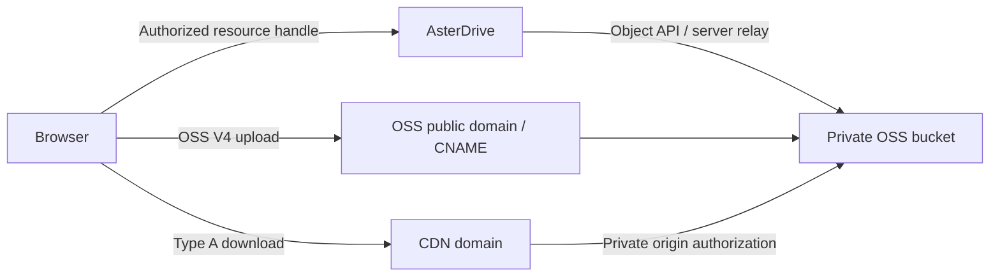

See the [provider evidence index](https://drive.docs.astercosm.com/developer/en/reference/storage-provider-evidence/#alibaba_oss) for protocol sources, versions, review status and cloud acceptance boundaries. Validate origin APIs, upload endpoints, CDN and custom domains separately.

:::tip[What this page covers]
This page explains how to store AsterDrive files in Alibaba Cloud Object Storage Service. AsterDrive uses native `OSS4-HMAC-SHA256` signing; it does not disguise a native OSS policy as generic S3-compatible storage.
:::

## When to Choose Alibaba Cloud OSS

- You already have an OSS bucket and need native endpoint and region semantics
- AsterDrive backend traffic should use an OSS internal endpoint while browser direct transfers use the public endpoint
- The bucket is bound to a custom CNAME domain
- You need `relay_stream`, `presigned`, and multipart upload paths

An endpoint that merely resembles S3 does not provide native OSS behavior. OSS V4 uses a different algorithm, credential scope, canonical URI, and query-signing contract from AWS SigV4.

## Entry Points

| Task | Location |
| --- | --- |
| Create the bucket and AccessKey | Alibaba Cloud OSS console |
| Configure bucket CORS | `Admin -> Storage Policies -> Alibaba Cloud OSS policy -> Configure CORS` |
| Create the policy | `Admin -> Storage Policies -> New Policy -> Alibaba Cloud OSS` |
| Assign users or teams | `Admin -> Policy Groups` |
| Compare `relay_stream` and `presigned` | [Storage Capability Matrix](/en/reference/storage-matrix/) |

## 1. Prepare the OSS Bucket

1. Create a dedicated bucket and record its region, for example `cn-hangzhou`
2. Record the public endpoint, for example `https://oss-cn-hangzhou.aliyuncs.com`
3. If AsterDrive and OSS share a cloud network, record a server-side internal endpoint such as `https://oss-cn-hangzhou-internal.aliyuncs.com`
4. Create an AccessKey scoped to this bucket with the object read, write, delete, list, and multipart permissions AsterDrive needs
5. If you plan to use `presigned`, configure OSS CORS for the AsterDrive site

:::caution[Alibaba Cloud international-site accounts]
The [Alibaba Cloud China documentation](https://help.aliyun.com/zh/oss/user-guide/regions-and-endpoints) continues to list `oss-cn-<region>.aliyuncs.com` as the public endpoint for Chinese mainland regions, so the default configuration above applies to China-site accounts. Alibaba Cloud [separately states](https://www.alibabacloud.com/en/notice/oss_update_notice_policy_change_in_calling_data_api_operations_via_the_default_public_domain_name_45a) that international-site users who activate OSS after March 20, 2025 at 00:00:00 (UTC+8) cannot call data API operations for buckets in Chinese mainland regions through default public domain names. International-site users who activated OSS before that time and internal domain names are not affected. If a request returns `PublicEndpointForbidden` (HTTP 400, EC `0048-00000401`), [bind a custom domain to the bucket](https://www.alibabacloud.com/help/en/oss/user-guide/access-buckets-via-custom-domain-names), enable **Use a custom domain (CNAME)**, and use that domain as the public endpoint. Browser presigned uploads and downloads must also use the CNAME domain in this case.
:::

Do not paste the AccessKey into logs, screenshots, or issues. AsterDrive encrypts connector credentials at rest; backups and migrations must also preserve `[auth].storage_credential_secret_key`.

## 2. Understand the Three Endpoint Settings

| Field | Purpose |
| --- | --- |
| Public endpoint | Generates browser-visible presigned URLs; also handles backend I/O when no server-side endpoint is set |
| Server-side endpoint | Optional and used only by AsterDrive backend requests; never appears in browser presigned URLs |
| Use a custom domain (CNAME) | Treats the public endpoint as a custom domain already bound to the current bucket |

In normal mode, endpoints must use an `aliyuncs.com` OSS hostname. In CNAME mode, the public endpoint must be a custom domain. The bucket remains part of the OSS V4 canonical URI but is not repeated in the transmitted URL path.

:::caution[CNAME does not replace the server-side endpoint]
When a server-side endpoint is configured, backend I/O uses it while browser presigned URLs continue to use the public endpoint. Validate DNS, HTTPS, and reachability for the backend and browser paths separately.
:::

### CNAME Configuration Example

Bind the custom domain to the target bucket in the OSS console, complete domain-ownership verification and the DNS CNAME record, and configure a trusted HTTPS certificate covering the domain. Use an object API domain rather than a static-website endpoint.

| Setting | Example |
| --- | --- |
| Bucket | `asterdrive-test-bucket` |
| Region | `cn-hangzhou` |
| Public endpoint | `https://files.example.com` |
| Use a custom domain (CNAME) | Enabled |
| Server-side endpoint | Optional `https://oss-cn-hangzhou-internal.aliyuncs.com`; use an official OSS endpoint reachable by the backend |
| Base path | `prod/`; do not put it in the endpoint |

Browser object URLs should resemble `https://files.example.com/prod/object-key`, without `/asterdrive-test-bucket/`. CNAME aliases the OSS API and does not enable CDN. Put a CDN-only domain in **Download delivery URL**. Validate CNAME presigned PUT, multipart, and GET before adding CDN so failures in the two paths remain distinguishable.

## 2.1 Optional: CDN Download Delivery

AsterDrive supports **Alibaba Cloud CDN Type A URL authentication only**. The default **Download delivery mode** is **OSS origin (OSS V4)**. Selecting **Alibaba CDN accelerated download (Type A)** reveals the delivery URL, validity, and key; domain and key are required in that mode. Configure the CDN key separately from the OSS AccessKey: OSS V4 authenticates the object API and CNAME, while Type A authenticates CDN downloads. Upload, delete, list, multipart, cleanup, and server-side relay continue to use the OSS API endpoint.

| Field | Purpose |
| --- | --- |
| Download delivery mode `download_delivery` | Default `oss_origin`; select `alibaba_cdn_type_a` for CDN |
| Download delivery URL `download_base_url` | Required HTTPS acceleration domain in CDN mode, for example `https://cdn.example.com`; no credentials, query, fragment, or path |
| CDN authentication validity (seconds) | Must match the CDN console's Authentication URL Validity Period; default 300 seconds, range 1–31536000 seconds |
| CDN authentication key | Required when a CDN domain is set; use the Type A primary or backup key, containing 6–128 ASCII letters or digits; stored encrypted |

Keep the two paths distinct:



**The normal connection test probes the OSS endpoint.** It does not read or modify the CDN control plane or prove Type A authentication, CDN CORS, or cache-hit authorization.

Setup:

1. Add an acceleration domain in the Alibaba Cloud CDN console, select the current OSS bucket as origin, and configure HTTPS
2. Open **CDN Console -> target domain -> Origin Settings -> Private OSS Bucket Access**, enable private-origin access, choose same-account access when appropriate, and complete the requested authorization. Select **OSS Domain** as the origin type and use the target bucket domain as origin Host. Separately enable **Type A URL authentication** under access control and record the primary or backup key
3. Set the console's Authentication URL Validity Period and AsterDrive's **CDN authentication validity (seconds)** to the same value, for example 300 seconds. Configure this under **Domain Management -> target domain -> Access Control -> URL Authentication**, protecting every file and path, including extensionless object keys
4. Set downloads to `presigned`, select **Alibaba CDN accelerated download (Type A)**, and fill in the revealed delivery URL, key, and validity fields
5. Configure CORS on the CDN domain for the AsterDrive origin, including GET and Range downloads; OSS bucket CORS alone is insufficient
6. Preserve path case and encoding without rewrites. Type A removes authentication parameters after verification before using the object cache. Filtering cache-key queries does not strip origin queries: restrict unexpected business parameters so unsigned `response-*` cannot change origin responses
7. Verify browser caching headers, for example `Cache-Control: private, no-store`. Configure and validate edge caching separately; browser caching does not define authentication lifetime

:::caution[Client authentication and origin authorization are separate]
Private OSS origin authorization does not authenticate CDN clients. Enable Type A in the CDN console. AsterDrive rejects CDN delivery with a missing or invalid domain or key. Keep both validity settings synchronized; AsterDrive cannot read the console configuration automatically.
:::

### Link Validity and Cache Retention

[Type A](https://help.aliyun.com/zh/cdn/user-guide/type-a-signing) uses `auth_key=timestamp-rand-uid-md5hash`, signing the encoded object path. CDN expiration is `timestamp + console validity`. AsterDrive caps the link lifetime at the smaller of the caller's requested lifetime and the configured validity, backdating the signing timestamp for shorter requests. The returned `expires_at` therefore matches the real deadline instead of adding the two lifetimes together.

**Authentication validity is separate from CDN cache retention.** CDN cache rules and origin response headers determine edge retention. Expired or tampered authentication URLs must return 403 even for cached objects. Anyone holding a valid link can use it until expiration; rotate the CDN key for emergency revocation.

With a configured validity of 300 seconds, a 300-second request uses the current signing time. A 60-second request backdates the timestamp by 240 seconds and expires 60 seconds from now. **Do not place now plus 300 seconds in the timestamp**: CDN would add the console validity again.

### CDN CORS Checklist

| Setting | Check |
| --- | --- |
| Allowed origin | The full AsterDrive origin, for example `https://drive.example.com`, without a path |
| Methods | GET and HEAD; actual Range requests and their preflights must succeed |
| Request headers | Allow headers actually sent, such as `Range`; AsterDrive cookies are not required |
| Exposed headers | Expose `Content-Length`, `Content-Range`, `Accept-Ranges`, and `ETag` when needed |
| HTTPS | Use a valid HTTPS URL with a matching certificate, without relying on cross-origin HTTP redirects |

A successful server-side `curl` does not prove browser CORS. Check the browser Network panel and console too. Signed URLs are temporary credentials; do not publish screenshots containing their full query.

### Requests That Use CDN

- Authorized browser Blob downloads and safe previews can use CDN. The frontend saves downloads under the current file name and uses MIME metadata from the resource handle
- Direct navigation, external viewers, and attachment routes requiring strict response headers use same-origin relay; inline previews requiring isolation, such as HTML, retain their safety boundary
- Type A does not authenticate arbitrary business query parameters. AsterDrive does not append unsigned `response-*` parameters to CDN URLs or rely on them for file names or content types
- Selecting **OSS origin (OSS V4)** uses the OSS public endpoint or CNAME for `presigned` downloads; hidden CDN settings do not activate CDN

### Validate CNAME and CDN Separately

Use dedicated test files to check:

1. CNAME presigned PUT and multipart-part URLs use the OSS custom domain and `x-oss-signature`, without repeating the bucket in the path or using the CDN domain
2. Browser Blob downloads and image previews use the CDN domain and `auth_key`, preserving the base path; saving a renamed file uses its current name
3. CDN Range downloads return the correct bytes; expose required Range response headers through CORS
4. Valid signatures work; tampering with the path, digest, or timestamp, and waiting for expiration, causes CDN rejection even on a cache hit
5. Direct navigation, external viewers, and isolated inline previews retain relay and their attachment, file-name, and MIME semantics

An administrator with Alibaba Cloud resources must validate real OSS CNAME, edge authentication, CORS, and caching. Local tests do not prove cloud acceptance.

Test unsigned, wrong-key, path/time/digest-tampered, and expired links. Run negative cases before cache population and repeat after a valid request fills the cache. Cache hits must not make invalid links readable. Synchronize key rotation and check old links; changing share permissions does not immediately revoke issued CDN links.

Official references: [Configure URL signing](https://help.aliyun.com/zh/cdn/user-guide/configure-url-signing) and [Type A](https://help.aliyun.com/zh/cdn/user-guide/type-a-signing).

## 3. Create the AsterDrive Storage Policy

Under `Admin -> Storage Policies`, create **Alibaba Cloud OSS** and fill in:

- Public endpoint
- Optional server-side endpoint
- OSS region
- Bucket
- Optional base path
- CNAME mode
- Download delivery mode; delivery URL, validity, and key are shown only for CDN mode
- AccessKey ID / AccessKey Secret
- Upload and download modes

Start with `relay_stream` for connection testing and end-to-end validation. After server-side reads, writes, Range requests, deletes, copies, and multipart operations are stable, switch to `presigned` if needed. When a Download delivery URL is configured, validate the CDN download path separately.

## 4. Configure CORS for Presigned Transfers

The current browser-to-OSS paths use `PUT` for object and part uploads and `GET` / `HEAD` for object reads. AsterDrive handles multipart initiation, completion, and cancellation on the backend. Allow upload `Content-Type` and download `Range`; expose `ETag` for multipart completion and `Content-Length`, `Content-Range`, `Accept-Ranges`, and `Content-Disposition` for downloads. Single-object presigned PUT completion verifies metadata and size on the server, so it does not need browser access to `ETag`.

### Configure CORS from AsterDrive

Set a valid **Public site URL** under `Admin -> System Settings -> Site`, open the Alibaba Cloud OSS policy, and choose **Configure CORS**. Confirm with the standard remote-state change prompt. The action supports new drafts, edited drafts, and saved policies. Blank AK/SK fields on an edited draft reuse that policy's saved credentials; the action always uses the current form's bucket and endpoint. Saving a policy or testing its connection never writes CORS.

The action reads existing bucket rules before appending the AsterDrive rule. It skips the write when a fully equivalent rule exists, preserves unrelated rules and order, and does not claim or delete a rule merely because it contains the site origin. If the Public site URL changes, an old-origin rule may remain; review and remove it manually in OSS. Read failures, unsupported fields that cannot be preserved, more than 20 rules, or XML larger than 16 KB stop the write. Avoid editing the same bucket CORS concurrently elsewhere: OSS replaces the complete configuration and cannot guarantee preservation against external concurrent writes.

Grant `oss:GetBucketCors` and `oss:PutBucketCors` on the target bucket to the action's AccessKey. Permission errors show only a sanitized provider code and actionable permission hint. The action changes bucket CORS only; it does not change bucket policy, public access, CDN, or hotlink protection. Validate OSS origin, separate upload domains, and CDN/custom download domains independently in a real browser. A successful write does not prove every browser path works. See Alibaba Cloud [GetBucketCors](https://help.aliyun.com/zh/oss/developer-reference/getbucketcors) and [PutBucketCors](https://help.aliyun.com/zh/oss/developer-reference/putbucketcors).

If the connection test succeeds but browser direct transfer fails, check:

1. The browser URL uses the public endpoint or CNAME, not the internal endpoint
2. CORS `AllowedOrigin` exactly matches the origin in the browser address bar
3. Multipart part `ETag` responses are visible to browser JavaScript
4. The custom-domain TLS certificate covers the selected hostname

## 5. Create a Test Policy Group and Bind Users or Teams

Start with a dedicated OSS policy instead of changing the default policy group. Open:

```text
Admin -> Policy Groups
```

Create an OSS Test Group with a rule selecting the new OSS policy. Cover the test files' size range and check that another higher-priority rule does not match first.

- Personal space: bind the test user under `Admin -> Users -> User Details`
- Team space: bind the test team under `Admin -> Teams -> Team Details`; team uploads use the team's policy group, not the personal user's group

The storage policy determines where data is stored, policy-group rules choose the policy for an upload, and bindings choose who uses those rules. Creating a policy alone does not redirect all uploads.

## 6. Validate in Stages

| Stage | Action | Expected result |
| --- | --- | --- |
| OSS relay | Upload a small file, compare downloaded content, delete and restore | File records and bytes agree; objects use the intended bucket and base path |
| Multipart | Upload a large file, resume it, then separately test cancellation | Correct part/finalization state; cancellation leaves no completable session |
| CNAME direct upload | Select `presigned` uploads for single and multipart files | Browser uses the reachable CNAME; part ETags are readable |
| OSS direct download | Use `presigned` without CDN | OSS V4, correct names, Range, PDF/video seeking |
| CDN delivery | Configure Type A and execute the CDN checklist above | Blob downloads/safe previews use CDN; negative authentication tests also hold on cache hits |
| Files and shares | Copy, move, rename, conflict handling, and public-share download | Correct ownership, permissions, and current names; strict requests retain relay |

Check background tasks, browser Network/CORS errors, and OSS/CDN errors. Connection tests cover endpoint access and storage credentials, not these full flows. Keep unexecuted cloud cases pending instead of treating local signatures as cloud acceptance.

## 7. Move Production Traffic

After the test group passes, change real user or team bindings. To move existing objects, create a target policy and use `Admin -> Storage Policies -> Migrate Data`; verify downloads and migration completion before switching rules.

:::caution[Do not relocate an existing policy directly]
Do not edit an existing policy's bucket, endpoint, region, CNAME, or base path to move data. Those fields determine old-object locations and signing. Manually moving, renaming, or deleting blob objects in the cloud console also breaks database/storage consistency.
:::

## Troubleshooting

### `SignatureDoesNotMatch`

Confirm that the region matches the bucket endpoint, credentials contain no extra whitespace, system time is correct, and the native OSS policy was not entered through the generic S3 connector.

### Backend Works but Browser Presigned URLs Fail

The server-side endpoint only proves backend reachability. Check the public endpoint / CNAME, HTTPS, DNS, and CORS separately.

### The Bucket Appears Again in a CNAME URL

Enable **Use CNAME custom domain** and make sure the public endpoint is the custom domain bound to the bucket, not an `aliyuncs.com` provider endpoint.

### CDN Download Returns 403

Identify which layer returned the error:

- An OSS XML response with `AccessDenied`, `You have no right to access this object because of bucket acl.`, an OSS `HostId`, or `EC=0003-00000001` points first to **CDN-to-OSS private-origin authorization**, origin Host, and Bucket Policy. Changing the Type A key does not fix origin permissions; keep the bucket private
- For same-account origins, enable private OSS access in the CDN settings above and complete authorization. CDN does not inherit the OSS AccessKey saved in AsterDrive
- For cross-account or RAM AccessKey origins, grant the origin identity the required target-bucket permissions before configuring CDN private-origin access. The official error reference notes that reversing this order can prevent STS authentication configuration from reaching CDN nodes
- After authorization, obtain a fresh signed link and test an uncached object. Refresh an object with a cached error when necessary. An OSS error alone does not fully prove that client-side Type A authentication is correct

References: [Private-origin setup for CDN and OSS](https://help.aliyun.com/zh/oss/user-guide/use-cdn-to-accelerate-access-to-oss) and [OSS error 0003-00000001](https://help.aliyun.com/zh/oss/support/0003-00000001).

Confirm that Type A is enabled in the CDN console, both sides use the same key and Authentication URL Validity Period, system time and object-path encoding are correct, and the link has not expired. Never paste keys or complete signed URLs into logs or issue reports.

### CDN Is Configured but Downloads Still Use AsterDrive

Check `presigned` downloads, **Alibaba CDN accelerated download (Type A)** delivery mode, the test user/team's selected policy, and whether the request is a Blob download or safe preview that permits provider headers. Direct navigation, external viewers, strict attachments, and isolated inline previews deliberately use relay. Browsers without streaming file-save support also use the existing attachment route.

### Server-side CDN Requests Work but Browsers Fail

Check CORS on the CDN domain itself, TLS, and the browser's actual origin; OSS bucket CORS is not enough. Browser CDN requests should not carry AsterDrive cookies or add conditional request headers.
