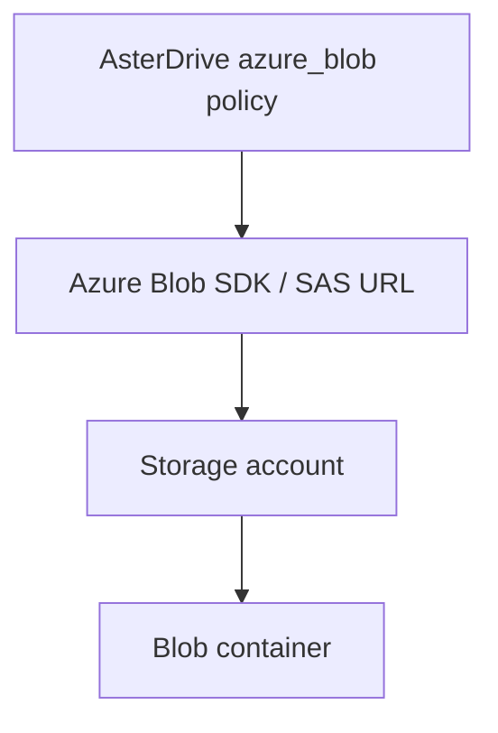
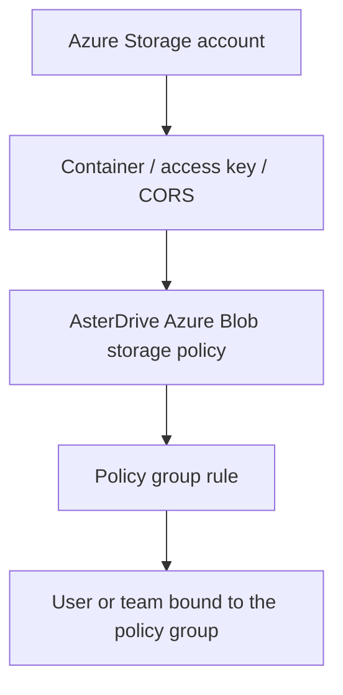
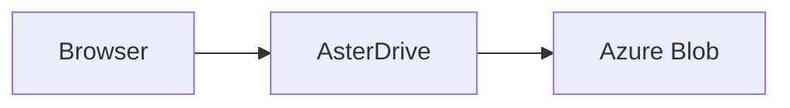
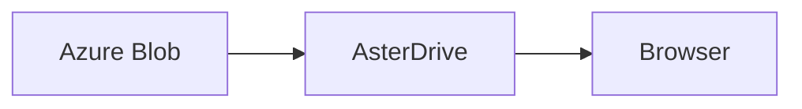
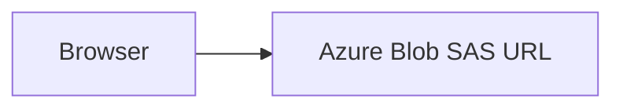

:::tip[What this page covers]
This page walks through the complete flow for writing AsterDrive files to Azure Blob Storage: prepare a storage account and container, create an `azure_blob` storage policy, configure policy group rules, bind users or teams, verify uploads and downloads, and choose between server relay and browser-direct transfer.
:::

## When to Use It

Azure Blob Storage is suitable when:

- You already use Azure Storage accounts and Blob containers
- You want Azure to carry file capacity, object persistence, and download bandwidth
- You want AsterDrive to use the Azure Blob SDK instead of treating Azure as S3-compatible storage
- Your administrators already manage Azure network rules, access keys, billing, and lifecycle policies

If you use S3, MinIO, R2, or another S3-compatible service, see [S3 / MinIO / R2 Storage Policy Tutorial](/en/admin/storage-backends/s3/). If you use Tencent COS and need COS CI capabilities, see [Tencent COS Storage Policy Tutorial](/en/admin/storage-backends/tencent-cos/).

## Azure Blob Is Not S3-Compatible Storage

In AsterDrive, `azure_blob` is an independent storage backend. It does not use the S3-compatible API.



Keep these names separate:

| AsterDrive field | Azure concept | Notes |
| --- | --- | --- |
| Endpoint | Blob service endpoint | For example `https://<account>.blob.core.windows.net` |
| Bucket / Container | Container | Azure calls this a container, not a bucket |
| Access Key / Storage account name | Storage account name | This is not an Access Key ID |
| Secret Key / Storage account key | Storage account key | Used by the server to sign SAS URLs |
| Base path | Blob name prefix | Optional prefix under the container |

## First, Separate the Layers



Creating only an Azure Blob storage policy is not enough. When users or teams upload files, they first match a policy group, and then a policy group rule assigns the upload to a storage policy.

## Entries Used in This Page

| What you want to do | Entry |
| --- | --- |
| Create an Azure Blob policy | `Admin -> Storage Policies -> New Policy` |
| Test the Azure Blob connection | `Admin -> Storage Policies -> Test Connection` |
| Create routing rules | `Admin -> Policy Groups` |
| Bind a policy group to a user | `Admin -> Users -> User Details` |
| Bind a policy group to a team | `Admin -> Teams -> Team Details` |
| Adjust the public site URL | `Admin -> System Settings -> Site Configuration -> Public Site URL` |

## 1. Prepare the Storage Account and Container

Create or choose an Azure Storage account, for example:

```text
asterdriveprod
```

Then create a dedicated container, for example:

```text
asterdrive-prod
```

It is recommended to allocate a dedicated prefix for AsterDrive:

```text
prod/
```

Objects are then expanded under that prefix using AsterDrive's content-addressed paths. Do not let multiple AsterDrive instances write to the same prefix unless you clearly know that they will not overwrite each other or clean up each other's objects.

:::caution[Do not manually move blobs in the container]
The AsterDrive database records object paths. Manually moving, renaming, or deleting Azure blobs will make database file records inconsistent with the real objects.
:::

## 2. Prepare Access Credentials

AsterDrive currently uses the storage account name and account key to access Azure Blob.

In the Azure Portal, find:

```text
Storage account -> Security + networking -> Access keys
```

Prepare these values:

| Value | AsterDrive field |
| --- | --- |
| Storage account name | `Access Key / Storage account name` |
| key1 or key2 | `Secret Key / Storage account key` |
| Blob service endpoint | `Endpoint` |
| Container name | `Bucket / Container` |

If your organization uses a stricter key rotation process, you can configure a new policy with `key2`, validate it, and then move policy groups over. Do not directly change the endpoint, container, or base path of a policy that already has active uploads or existing files.

## 3. Choose Upload and Download Modes First

For the first connection, start with the conservative route:

| Direction | Initial recommendation | Reason |
| --- | --- | --- |
| Upload mode | `relay_stream` | The browser does not need to reach Azure Blob directly, so CORS is less likely to block you |
| Download mode | `relay_stream` | Downloads also go through AsterDrive first, making troubleshooting easier |

After basic reads and writes work, you can consider switching to:

- upload `presigned`
- download `presigned`

### How `relay_stream` Works

Upload path:



Download path:



This keeps the entry point centralized and easy to debug. The tradeoff is that the application node carries upload and download bandwidth.

### How `presigned` Works

For Azure Blob, `presigned` uses Azure SAS URLs. It is not an S3 presigned URL.

Upload path:



Download path:


This reduces bandwidth load on the AsterDrive node. It requires the browser to reach the Azure Blob endpoint, and the account's Blob service CORS settings must allow the browser origin.

Presigned downloads use the current AsterDrive filename and MIME type, together with the download cache policy. Objects stored under UUID names and files renamed in AsterDrive download with the current filename when a new URL is requested; no Azure object move is needed. Existing SAS URLs retain the filename from issuance until they expire.

AsterDrive sets these response headers when generating the SAS. CORS `Exposed headers` only lets scripts read existing response headers; it does not set the download filename.

## 4. Create the Azure Blob Storage Policy in AsterDrive

Open:

```text
Admin -> Storage Policies -> New Policy
```

Choose the driver type:

```text
Azure Blob
```

Fill in:

| Field | Example | Notes |
| --- | --- | --- |
| Endpoint | `https://asterdriveprod.blob.core.windows.net` | Blob service endpoint; a trailing `/` is normalized |
| Bucket / Container | `asterdrive-prod` | Azure container name |
| Access Key / Storage account name | `asterdriveprod` | Storage account name; AsterDrive trims leading/trailing spaces before saving |
| Secret Key / Storage account key | `...` | Storage account key; AsterDrive trims leading/trailing spaces before saving |
| Base path | `prod/` | Optional blob name prefix |
| Upload mode | Start with `relay_stream` | Switch to `presigned` after validation |
| Download mode | Start with `relay_stream` | Switch to `presigned` after validation |

:::caution[Use the Blob service endpoint]
Do not paste the Azure Portal URL, container URL, or a SAS URL into Endpoint. Endpoint should look like `https://<account>.blob.core.windows.net`. The container is entered separately in the Bucket / Container field.
:::

## Custom Domains and Front Door Download Delivery

Supported delivery uses client SAS with Azure Front Door Standard/Premium. Existing policies default to Blob origin when the new fields are absent. Account credentials remain unchanged; no separate CDN credential or `azure_use_cname` switch is needed.

| Field | Value |
| --- | --- |
| Endpoint | Blob API address, e.g. `https://myaccount.blob.core.windows.net`, or an HTTPS proxy supporting the complete Blob API |
| Download strategy | `presigned` uses the selected delivery; `relay_stream` always uses AsterDrive while retaining delivery settings |
| Download delivery mode | `azure_blob_origin` (default) or `azure_front_door_sas` |
| Download address | Required for Front Door, e.g. `https://files.example.com`; HTTPS domain only, without container, path or SAS |
| CDN cache time (seconds) | `0–31622400`, default `0` (disabled); maximum 366 days |

Only browser-facing presigned downloads and eligible previews use Front Door. Uploads, SAS PUT, blocks, list, copy, backend reads, cleanup, connection tests and CORS management retain Endpoint. Inline content requiring same-origin isolation retains AsterDrive relay. Download errors do not reroute other operations to Front Door.

Example `connector_config.values` (account credentials remain separately in `credential`):

```json
{
  "endpoint": "https://myaccount.blob.core.windows.net",
  "bucket": "archive",
  "base_path": "files",
  "object_storage_upload_strategy": "presigned",
  "object_storage_download_strategy": "presigned",
  "download_delivery": "azure_front_door_sas",
  "download_base_url": "https://files.example.com",
  "azure_cdn_cache_max_age_seconds": 300
}
```

Object `report.pdf` downloads from `https://files.example.com/archive/files/report.pdf?...SAS...`. The container is appended once. The SAS canonical resource remains `/blob/myaccount/archive/files/report.pdf`. The driver encodes Unicode, spaces and literal percent signs and signs filename, MIME and cache overrides.

### Azure Console Setup

1. Create Front Door Standard/Premium, configure the download domain and TLS certificate. Set origin and Origin host header to the real Blob account host. Leave Origin path empty and do not rewrite container/object paths.
2. Forward the complete client SAS query and `rscc`, `rscd`, `rsct`. Do not remove or rewrite them, or inject a fixed origin SAS to replace client SAS.
3. Select **Use Query String** including all query parameters: SAS signature, expiry and response overrides. Do not cache by object path alone.
4. Respect origin `Cache-Control`. Configure and verify CORS, OPTIONS, GET, HEAD and Range on the download domain. Upload CORS remains on Blob origin.
5. Standard requires a reachable origin; Premium can use Private Link following the official setup. Private Link isolates the origin network, not end-user authorization.

References: [Storage Blobs scenario](https://learn.microsoft.com/azure/frontdoor/scenario-storage-blobs), [Front Door caching](https://learn.microsoft.com/azure/frontdoor/front-door-caching), [Service SAS](https://learn.microsoft.com/rest/api/storageservices/create-service-sas).

### Cache and Authorization Boundaries

- `0` signs `rscc=private, max-age=0, must-revalidate`, preventing Front Door caching.
- Positive `N` signs `rscc=public, max-age=0, s-maxage=N`, permitting shared edge caching while browser caches must revalidate.
- Retention starts when the origin response enters the cache; SAS expiry starts at issuance. Cache hits do not ask Blob to revalidate SAS, so an old URL can still hit after SAS expiry. Different SAS URLs create separate cache entries and frequent issuance can reduce hit rates.
- Permission changes, deletion, renaming and policy edits do not immediately remove cached copies or revoke issued URLs. Purge Front Door manually for emergency removal. Keep cache time `0` when origin authorization/expiry must be checked on each request, or deploy separate edge authorization. This feature does not create edge authorization or automatically purge caches.

### Endpoint and Real-Provider Acceptance

Endpoint must be an absolute HTTP(S) URI without credentials, query, fragment, control characters or `..` segments. HTTPS is required except for local Azurite loopback endpoints; download addresses always require HTTPS. Azure direct CNAME mapping only supports HTTP; use Front Door or an HTTPS proxy for TLS. Static website endpoints are not the Blob API and cannot serve private file operations. Put full Blob API proxies in Endpoint and download-only Front Door domains in Download address.

Local tests prove configuration, SAS, routing, response headers and browser forms; Azurite proves Blob API behavior only. Verify real Front Door certificates, private origins, CORS, cache misses/hits, hits after SAS expiry and purge separately with your Azure resources.

## 5. Test the Connection Before Saving Production Routing

Before or after saving, use the admin-console connection test to confirm:

- AsterDrive can reach the endpoint
- the container exists
- the account name and key can sign and perform object operations
- the base path is correct
- if you use `presigned`, browsers can also reach the endpoint

When editing an existing policy, leaving the storage account name or account key fields blank lets the draft connection test reuse the credentials already saved for that policy. This lets you test endpoint, container, base path, or upload-mode changes without pasting the account key every time. New policies have no saved credentials to reuse, so required credentials still need to be filled in.

When a connection test fails, the admin console shows a useful reason while hiding account keys and other sensitive values.

If the connection test fails, do not move users to this policy yet. Check in this order:

1. Endpoint includes `http://` or `https://`
2. Endpoint is the Blob service endpoint
3. Container name is correct
4. Storage account name is correct
5. Storage account key was copied completely
6. The AsterDrive server clock is accurate
7. The server network can reach the Azure Blob endpoint
8. If private networking, dedicated links, or firewalls are involved, the AsterDrive server network is allowed

## 6. Configure CORS

With `relay_stream`, browsers do not contact Blob Storage directly. Browser `presigned` uploads, block uploads, downloads and Blob previews require CORS on the source service.

### Automatic configuration

1. Set the actual browser origins in `Admin -> System settings -> Site -> Public site URL`, such as `https://drive.example.com`. Multiple explicit origins are supported. Origins use browser serialization: default HTTP port `80` and HTTPS port `443` are omitted, and duplicates are merged.
2. In a new or existing Azure Blob policy form, fill in the current connection and click **Auto configure Azure Blob CORS**. Blank credentials in an edited draft reuse that policy's saved credentials; new drafts require complete credentials.
3. Review the current account, endpoint and account-wide scope, then confirm using the same action confirmation flow as COS. Clicking the action opens the confirmation. After confirmation, the backend reads the current connection and public site origins and configures CORS.
4. Review whether configuration changed, the preserved rule count and Azure request ID, then verify real browser operations.

:::caution[All Blob containers in the account are affected]
CORS belongs to the entire storage account currently used by the policy and affects all its Blob containers. Review this scope when other applications share the account.
:::

The action accepts the primary account Blob service endpoint on official Azure public, China, US Government and Germany cloud domains. It authenticates with the current storage account name and account key using Shared Key. Management requests target the account Blob Service root path. Loopback Azurite endpoints are supported for protocol tests. Configure custom origin domains, Private Link specific domains and other unrecognized endpoints manually in Azure Portal.

AsterDrive requires sufficient permissions to update Blob Service CORS. The account must allow Shared Key, and Azure network rules must permit Blob Service access from the server running AsterDrive or its outbound network. The action authenticates at account scope using the account name and account key. If your organization requires another authentication method, configure CORS through Azure Portal according to its policy. Permission errors include sanitized provider codes, request IDs and actionable permission guidance.

The action reads existing CORS first and preserves every rule and their relative order. It appends a rule only when no fully equivalent rule exists. Equivalence includes origins, methods, request headers, exposed headers and cache duration, ignoring list order and header-name casing. An origin match alone never establishes ownership or permits replacement/deletion. Changing site origins does not automatically remove old rules. Other service properties are preserved by omitting their XML root elements from the write request.

Azure selects the first rule matching origin and method. If an existing rule overlaps the required rule, the action stops for manual resolution instead of reordering or rewriting rules. It also stops before writing on more than five rules, a combined value size over 2 KiB excluding XML tags, unknown CORS fields, failed reads or invalid XML. Successful writes are read back using the same rule order and field semantics. If Azure accepts the write but verification fails, the error explicitly warns that configuration may have changed and includes the write request ID when available; inspect the account configuration before retrying. The service properties API provides no conditional-write protection used by this action; avoid concurrent edits by administrators or external tools and inspect the final configuration.

### Generated rule and manual configuration

| Setting | Automatic value |
| --- | --- |
| Allowed origins | All normalized public site origins, explicitly listed without `*` |
| Allowed methods | `PUT,GET,HEAD` for single/block uploads and reads |
| Allowed headers | `content-type,range,x-ms-blob-type,x-ms-version` |
| Exposed headers | `ETag,Content-Length,Content-Range,Content-Disposition,Accept-Ranges,x-ms-request-id` |
| Max age | `600` seconds |

Use the same request contract for manual configuration. The browser page origin is required, rather than the backend's internal address. Exposed headers let scripts read existing response headers; they do not set download filenames.

A successful source configuration write proves only the source service was updated. Configure and test Front Door/CDN response headers, OPTIONS routing and caching separately, including distinct upload and download endpoints.

## 7. Create a Test Policy Group

Do not directly change the default policy group at the start. Create a test policy group first.

Open:

```text
Admin -> Policy Groups
```

Create a policy group, for example:

```text
Azure Blob Test Group
```

Add a rule:

| Field | Recommendation |
| --- | --- |
| Storage policy | The Azure Blob policy you just created |
| Priority | Keep the default or make it the first match |
| File size range | Cover all sizes first, so validation is straightforward |

## 8. Bind a Test User or Test Team

### Bind a User

Open:

```text
Admin -> Users -> User Details
```

Change the test user's policy group to `Azure Blob Test Group`.

### Bind a Team

Open:

```text
Admin -> Teams -> Team Details
```

Change the test team's policy group to `Azure Blob Test Group`.

Team workspace uploads use the team policy group, not the personal user's policy group.

## 9. Run Real Validation

Use a real account bound to the test policy group:

1. Upload a small file
2. Upload a large file that exceeds the chunk threshold
3. Download the files
4. Share a file and open the share link
5. Delete a file, then restore it from trash
6. Delete again and clear trash, then confirm Azure objects are cleaned up as expected

If you plan to enable `presigned`, test these as well:

1. Change upload mode to `presigned`
2. Upload small and large files
3. Confirm the browser can connect directly to Azure Blob
4. If using `presigned` downloads, confirm downloads and previews work

## FAQ

### Why Does the Admin Console Still Show a Bucket Field?

To stay consistent with other object-storage forms, some screens still show `Bucket`. For Azure Blob, it means **container**.

### Why Does `presigned` Fail While `relay_stream` Works?

`relay_stream` only requires the AsterDrive server to reach Azure Blob. `presigned` also requires the browser to reach the Azure Blob endpoint, and CORS must allow the browser origin to send `PUT` / `GET`.

Check first:

1. Can the browser reach the endpoint?
2. Do Storage account firewall rules allow the client network?
3. Does Blob service CORS include the public AsterDrive site origin?
4. Do allowed headers include `x-ms-blob-type`?
5. Is the SAS URL still within its validity window?

### Why Is HTTPS Required in Production?

Browser-direct addresses contain short-lived authorization information. Use an HTTPS Blob service endpoint in production so upload and download addresses are not sent over plaintext connections.

### Can I Directly Edit an Azure Policy Already in Use?

Do not directly change endpoint, container, or base path. Those fields determine where old files are located. A safer approach:

1. Create a new Azure Blob policy
2. Create a test policy group and validate it
3. If existing data must move, use `Admin -> Storage Policies -> Migrate Data`
4. After migration, switch users or teams to the new policy group

## Launch Checklist

- Storage account and container are ready
- Account name and key are correct, and the connection test passes
- Base path is planned and not shared with another instance
- Upload / download modes match your network conditions
- If using `presigned`, Blob service CORS is configured
- A test user can upload, download, share, delete, and restore files
- Large-file multipart upload works
- Production uses an HTTPS endpoint
- Azure storage capacity, request count, and egress cost boundaries are understood
