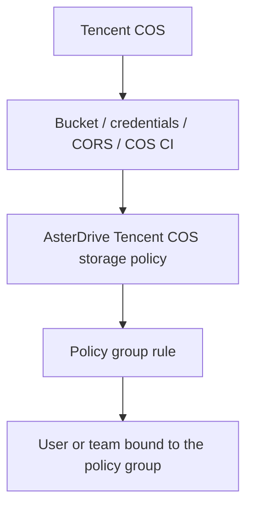
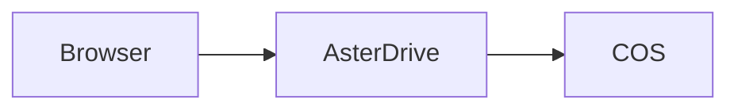
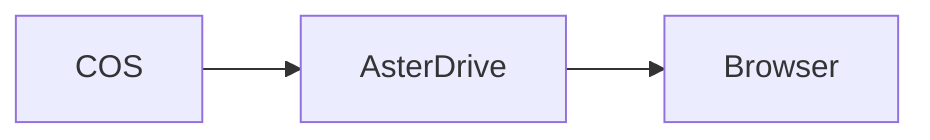
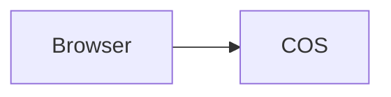
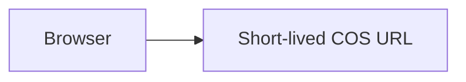

:::tip[What this page covers]
This page walks through the complete flow for writing AsterDrive files to Tencent COS: prepare a bucket, create a `tencent_cos` storage policy, configure policy group rules, bind users or teams, verify uploads and downloads, and understand the switches, suffixes, and billing boundaries for COS CI native processing.
:::

## When to Use It

Tencent COS is suitable when:

- You already use Tencent COS and want AsterDrive to write directly into a COS bucket
- You have many or large files and want object storage to carry capacity and bandwidth
- You want to enable Tencent-native COS CI features per storage policy, such as image thumbnails or media-info parsing
- You want the frontend and admin console to clearly show "Tencent COS" instead of hiding it under a generic S3-compatible backend

If you only need generic S3-compatible object storage and do not need Tencent COS CI features, use the [S3 / MinIO / R2 storage policy tutorial](/en/admin/storage-backends/s3/) instead.

## Choosing Between COS and Generic S3 Storage

Tencent COS supports standard object-storage operations and also provides Tencent-specific features such as COS CI. AsterDrive therefore shows it as a separate storage type.

Choose **Tencent COS** when you need Tencent features such as image thumbnails or media information. If you only need generic object storage, also see the [S3 / MinIO / R2 storage policy tutorial](/en/admin/storage-backends/s3/).

## First, Separate the Layers



Creating only a COS storage policy is not enough. When users or teams upload files, they first match a policy group, and then a policy group rule assigns the upload to a storage policy.

## Entries Used in This Page

| What you want to do | Entry |
| --- | --- |
| Create a COS policy | `Admin -> Storage Policies -> New Policy` |
| Test the COS connection | `Admin -> Storage Policies -> Test Connection` |
| Create routing rules | `Admin -> Policy Groups` |
| Bind a policy group to a user | `Admin -> Users -> User Details` |
| Bind a policy group to a team | `Admin -> Teams -> Team Details` |
| Configure global media processing | `Admin -> System Settings -> File Processing` |

## 1. Prepare the Bucket and Prefix

Create a dedicated bucket in the Tencent COS console, for example:

```text
asterdrive-prod-1250000000
```

It is recommended to allocate a dedicated prefix for AsterDrive:

```text
prod/
```

Objects are then expanded under that prefix using AsterDrive's content-addressed paths. Do not let multiple AsterDrive instances write to the same prefix unless you clearly know they will not overwrite each other or clean up each other's objects.

:::caution[Do not manually move objects in the bucket]
The AsterDrive database records object paths. Manually moving, renaming, or deleting objects in COS will make database file records inconsistent with the real objects.
:::

## 2. Prepare Access Credentials

Prepare a Tencent Cloud credential pair for AsterDrive that is used only for this bucket / prefix.

At minimum, it needs to cover:

- Reading objects
- Writing objects
- Deleting objects
- Operations required for large-file uploads
- Necessary access to the target bucket / prefix

If you enable COS CI, also confirm that the credential can make the corresponding CI processing requests, such as image processing or media-info parsing. Permission names and console entries may change with Tencent Cloud product updates; follow Tencent Cloud's latest documentation and console hints.

## 3. Choose Upload and Download Modes First

For the first integration, use the conservative path:

| Direction | Recommended initial value | Reason |
| --- | --- | --- |
| Upload mode | `relay_stream` | The browser does not need to connect directly to COS, so there are fewer CORS issues |
| Download mode | `relay_stream` | Downloads are also relayed by AsterDrive first, which makes troubleshooting easier |

After confirming basic reads and writes work, then consider switching to:

- Upload `presigned`
- Download `presigned`

:::caution[LightCOS requires server relay]
If you use a **[Light Cloud Object Storage (LightCOS)](https://cloud.tencent.com/document/product/1722/112004)** bucket, keep both upload and download modes set to `relay_stream`. LightCOS does not provide bucket-level CORS configuration, so browser `presigned` upload and direct download are not suitable.
:::

### How `relay_stream` Works

During upload:



During download:



The advantage is a single entry point and simpler troubleshooting. The trade-off is that the application node must carry upload and download bandwidth.

### How `presigned` Works

During upload:



During download:



The advantage is reduced bandwidth pressure on the AsterDrive node. The prerequisite is that browsers can access the COS endpoint and COS CORS is configured correctly.

## 4. Configure COS CORS

If you only use `relay_stream`, browsers do not directly request COS, so CORS is not the first priority.

If you use `presigned` upload, the COS bucket must allow browser cross-origin uploads. At minimum, check:

- `AllowedOrigin`: your public AsterDrive site URL
- `AllowedMethod`: includes `PUT`
- `AllowedHeader`: allows the headers used by upload requests
- `ExposeHeader`: includes `ETag` when using presigned multipart uploads

After a single presigned PUT completes, AsterDrive verifies the object's metadata and size on the server and does not depend on the browser reading `ETag`. Presigned multipart completion still needs each part's `ETag`, so CORS must continue to expose `ETag` when large-file direct uploads are enabled.

If you use `presigned` download, also confirm that browsers can access the returned COS download URL and that you accept response headers and cache behavior being controlled more by COS.

### Configure CORS Through AsterDrive

AsterDrive can execute a storage action for a Tencent COS policy from the admin console:

```text
Admin -> Storage Policies -> target COS policy -> Configure CORS
```

This feature applies to standard Tencent COS buckets, not LightCOS.

Before running the action, enter the public site addresses that users actually use to open AsterDrive:

```text
Admin -> System Settings -> Site -> Public Site URL
```

Each address must be a complete HTTP(S) origin such as `https://drive.example.com`. Do not include paths, query strings, or wildcards. AsterDrive serializes origins as browsers do: HTTP `:80` and HTTPS `:443` are omitted, non-default ports are retained, and duplicates are removed. Any invalid origin stops the action before writing.

AsterDrive creates or updates its own COS CORS rule from these addresses and preserves unrelated rules. Do not edit CORS for the same bucket in the Tencent Cloud console at the same time, because concurrent changes may overwrite each other.

The Tencent Cloud credential needs `name/cos:GetBucketCORS` and `name/cos:PutBucketCORS` on the target bucket. Only an explicit `NoSuchCORSConfiguration` is treated as an absent configuration; other read failures never proceed to a write. The merged configuration is limited to 100 rules and 64 KiB of XML, including escaping and the document declaration. Excess limits, unknown fields, or configurations that cannot be preserved reliably stop the action; unrelated rules are never removed to make room. Errors retain the status, filtered provider code and RequestId without echoing raw provider messages. If the action fails, first check the public site address, Access Key / Secret Key, bucket region, and CORS permissions.

A successful action confirms the origin bucket CORS write. Browser preflight, uploads, multipart, Range and response-header access still require separate acceptance; configure and verify CDN CORS independently.

## 5. Create a Tencent COS Storage Policy in AsterDrive

Open:

```text
Admin -> Storage Policies -> New Policy
```

Choose the driver type:

```text
Tencent COS
```

Common fields:

| Field | Example |
| --- | --- |
| Endpoint | `https://asterdrive-prod-1250000000.cos.ap-guangzhou.myqcloud.com` |
| Bucket | `asterdrive-prod-1250000000` |
| Use a custom domain (CNAME) | Off by default; enable for a custom source Endpoint |
| Access Key | Tencent Cloud secret ID |
| Secret Key | Tencent Cloud secret key |
| Prefix / base path | `prod/` |
| Download delivery method | Default COS origin / Custom origin download domain / Tencent CDN |
| Download delivery URL | Shown and required for custom-origin and CDN modes, for example `https://files.example.com/assets` |
| Upload mode | Use `relay_stream` for the first setup |
| Download mode | Use `relay_stream` for the first setup |

Use the COS endpoint shown in the Tencent Cloud console. You do not need to tune it as a generic S3 path-style service.

### Custom Source Domains

Follow Tencent Cloud's [custom source domain guide](https://cloud.tencent.com/document/product/436/36638) to bind the domain to the bucket's default origin or an enabled global acceleration origin, configure its CNAME, and bind an HTTPS certificate. Static-website origins are unsuitable for object API endpoints. Domain and certificate changes may take about 30 minutes; verify actual availability.

Enable **Use a custom domain (CNAME)** in AsterDrive and set Endpoint to, for example, `https://files.example.com`. Keep Bucket as `asterdrive-prod-1250000000`. Reads, writes, multipart, presigned URLs, COS CI, and CORS use that domain without adding the bucket to the URL. Endpoint contains only the scheme and host (optionally a port); put object prefixes in the base path. Paths, credentials, query, and fragments are rejected. Existing official-domain configurations need no changes.

Tencent Cloud's [Domain option](https://cloud.tencent.com/document/product/436/55437) applies to bucket and object APIs, and its [presigning guide](https://cloud.tencent.com/document/product/436/36121) signs the actual request Host. Use HTTPS directly to avoid the forced-HTTPS 302 redirect; COS-native requests do not follow redirects. AsterDrive does not require additional control-plane permissions to inspect domain bindings. Test connectivity, then verify browser presigning, COS CI, and CORS separately against the actual origin configuration. There is no automatic fallback to another domain.

Keep CDN-only download domains in the delivery URL below rather than using them as full object API endpoints.

### Choose the Download Delivery Method

**Download strategy takes priority over delivery mode.** `relay_stream` always uses AsterDrive relay; the saved delivery URL, CDN key, and validity remain dormant. These modes take effect only with `presigned` downloads.

| Delivery method | Address field | Browser request |
| --- | --- | --- |
| Default COS origin | Extra download URL is hidden | Uses the storage Endpoint, including a configured origin CNAME, with COS Q-Sign |
| Custom origin download domain (COS Q-Sign) | Shows and requires `download_base_url` | Appends the fixed path prefix, policy base path, and object key, then generates COS Q-Sign for the final host and request |
| Tencent CDN accelerated download (Type D + SHA-256) | Shows and requires the same `download_base_url`, plus CDN key and validity | Uses independent CDN authentication; see below |

Choose **Custom origin download domain** for a separate domain or reverse proxy that exposes the same object keys and accepts COS Q-Sign. This is independent of Endpoint CNAME addressing. Endpoint still owns backend I/O, uploads, cleanup, CORS, and bucket administration. Do not use a download-only domain as the full object API endpoint.

The delivery URL must use HTTPS and a DNS hostname. It may include a fixed path prefix, but no credentials, non-default port, query, fragment, backslashes, or traversal segments. Saving custom-origin or CDN delivery without an address is rejected. Switching to the default origin hides and preserves the address without using it for downloads; switching back allows reuse.

During upgrade, a data migration sets **Custom origin download domain (COS Q-Sign)** for old configurations with a nonempty download URL and no `download_delivery`, including saved policies, remote targets, and deferred cleanup snapshots. Explicit modes are preserved rather than inferred or overwritten; the default origin ignores dormant addresses. Configure origin CNAME using Endpoint and its CNAME switch.

Connection tests prove storage Endpoint access only. Validate private objects, Range, and response overrides on the independent domain separately. Default-mode URLs should use Endpoint; custom-origin URLs use the separate domain with `q-signature`; CDN URLs use `sign` / `t`. Uploads and multipart always use the storage Endpoint in all three modes.

### Private downloads through Tencent CDN

Select presigned downloads and **Tencent CDN accelerated download (Type D + SHA-256)**. Endpoint still owns uploads, backend reads, multipart, cleanup and bucket/CORS administration. Source CNAME addressing and CDN delivery are independent settings.

| AsterDrive field | Configuration |
| --- | --- |
| `download_base_url` | Required HTTPS CDN URL, optionally with a fixed path prefix; policy base path and object key are appended |
| `tencent_cdn_auth_key` | Independent of COS SecretKey; 6–32 ASCII letters/digits; encrypted at rest; blank edits preserve the saved key |
| `cdn_auth_validity_seconds` | 1–3600 seconds, default 300; must equal the CDN Type D validity |

Configure Tencent Cloud before enabling this delivery mode:

1. Use a private COS bucket, authorize the CDN service and enable private-origin authentication. COS origin Host is fixed to the bucket address. Keep the bucket private.
2. Enable **Type D / SHA-256**, signature parameter `sign`, timestamp parameter `t`, decimal Unix timestamps, matching key and validity. Authenticate **all files and paths**, including extensionless object keys.
3. Configure CDN HTTPS and browser CORS for your site, including GET/HEAD/Range and relevant exposed response headers. CDN requests omit AsterDrive cookies.
4. Preserve case-sensitive paths without rewriting. Type D automatically excludes its authentication parameters from the cache key after authentication. Cache-key filtering does not remove origin query parameters: restrict or strip unexpected business queries so unsigned `response-*` parameters cannot change origin responses. Send `Cache-Control: private, no-store` to browsers; configure and verify edge caching separately rather than equating browser and edge lifetimes.

AsterDrive computes `SHA256(key + encoded_path + timestamp)`, including the delivery path prefix, policy base path and object key. Chinese paths are encoded; literal percent signs retain their meaning. Expiration is `timestamp + CDN-configured validity`. Shorter requested lifetimes backdate the timestamp instead of granting the full configured window; timestamps are never future-dated. A longer cloud validity extends actual access, so both settings must match.

Type D does not authenticate business queries. CDN URLs therefore contain neither COS Q-Sign nor response-header override queries. **Browser Blob downloads and previews** can use CDN: downloads choose a local file target with the current name; previews use the authorized resource-handle MIME to reconstruct the Blob. Exact attachment names, strict response headers, direct media/iframe responses and sandboxed representations use existing same-origin relay. There is no public-URL fallback. Existing COS origin/custom-origin Q-Sign configurations retain their behavior.

The normal connection test probes the storage endpoint only; it does not read or alter CDN configuration. Using a non-sensitive test object, verify valid access plus rejection of unsigned, wrong-key, path/time/signature-tampered and expired requests, both **before and after cache population**. Also verify HEAD/Range, HTTPS, CORS and response headers. Local signing/form tests are not real-CDN acceptance.

:::caution[CDN URLs are bearer credentials]

Anyone holding a signed URL can forward and use it until expiry. Changing a share permission does not immediately revoke issued links. Type D binds neither Host nor HTTP method.

- Use distinct keys across security boundaries; do not share keys with untrusted CDN domains.
- Rotate cloud primary/backup keys and verify invalidation on cache hits.
- Keep the COS bucket private and enable CDN authentication for every object path.

:::

Official references: [origin configuration](https://cloud.tencent.com/document/product/228/41334), [authentication](https://cloud.tencent.com/document/product/228/41622), [Type D](https://cloud.tencent.com/document/product/228/41625), [cache keys](https://cloud.tencent.com/document/product/228/47671), and [official SDK AuthAlgorithm/Type D definitions](https://github.com/tencentcloud/tencentcloud-sdk-go/blob/28c6cd0071e848ec8220af0f9041b3d669583177/tencentcloud/cdn/v20180606/models.go). The Type D page illustrates MD5; SHA-256 support comes from `AuthAlgorithm=sha256` in the SDK and the current console. This mode computes SHA-256.

## 6. Test the Connection Before Saving

Before or after saving, use the admin-console connection test to confirm:

- The AsterDrive server can access the COS endpoint
- The bucket name is correct
- The credentials can read and write the target prefix
- The bucket region and endpoint match
- The server time is accurate

If the connection test fails, do not move users to this policy. Check in this order first:

1. Whether the endpoint is accessible from the AsterDrive server
2. Whether the HTTPS certificate is trusted
3. Whether the bucket name is correct
4. Whether the Access Key / Secret Key is correct
5. Whether credential permissions cover the target bucket / prefix
6. Whether the AsterDrive server time is accurate
7. Whether the bucket has the required COS / CI features enabled

## 7. Configure Storage-Native Processing

:::caution[Confirm billing before enabling this]
Storage-native processing calls Tencent COS CI. AsterDrive caches generated thumbnails, media information, and similar results so they are not processed on every view, but the first generation and provider-side processing requests can still incur charges.
:::

The entry is the **Storage-native processing** section in the COS storage policy editor.

### Master Switch

`Enable storage-native processing` is the master switch for the current policy. When disabled, this policy will not call COS CI features.

### Native Thumbnails

Native thumbnails require all of these conditions:

- `Enable storage-native processing` is enabled
- Thumbnail processor is `storage_native`
- `Native thumbnail extensions` matches the current file name

Suffixes are per-policy. For example:

```text
jpg, jpeg, png, webp, gif
```

Files that do not match continue through the global media processors.

### Native Media Info

Native media-info parsing requires all of these conditions:

- `Enable storage-native processing` is enabled
- `Enable native media info` is enabled
- `Native media info extensions` matches the current file name

The suffix list is empty by default. Even if `Enable native media info` is on, an empty list will not call COS CI.

Add only audio/video suffixes you intentionally want COS to parse on each COS policy, for example:

```text
mp4, mov, m4v, mkv, webm, mp3, m4a, flac, wav
```

Do not blindly add every possible suffix. AsterDrive caches media information, but the first parsing request still calls COS CI.

### Document Preview

AsterDrive currently does not provide COS document HTML preview. Tencent Cloud's current public pricing pages do not list a free quota for this feature, so check costs carefully before using similar processing features.

## 8. Free Quotas and Billing Boundaries

References last checked: 2026-06-02. Always confirm against Tencent Cloud's latest pages before enabling billing-sensitive features.

Under Tencent Cloud's current public pricing pages:

| Capability | Free-quota wording | AsterDrive-side note |
| --- | --- | --- |
| Basic image processing | 10 TB monthly free quota | Native image thumbnails use this; usage outside the free-quota rules is billed by Tencent Cloud |
| Video media-info retrieval | 6000 requests / 2 months after first use | Used by native media-info parsing |
| Video snapshot | 6000 requests / 2 months after first use | Review this quota before using related video processing |
| Document HTML preview | No free quota | Not currently provided by AsterDrive |

Tencent Cloud pricing, free quotas, expiration rules, and region differences may change. Before production launch, check Tencent Cloud's latest COS / COS CI pricing pages and console prompts.

References:

- [Tencent Cloud COS CI free quotas](https://cloud.tencent.com/document/product/460/36381)
- [Tencent Cloud COS CI basic image processing pricing](https://cloud.tencent.com/document/product/460/47483)
- [Tencent Cloud COS CI media processing pricing](https://cloud.tencent.com/document/product/460/58120)
- [Tencent Cloud COS CI document processing pricing](https://cloud.tencent.com/document/product/460/58121)

## 9. Create a Test Policy Group

Do not directly modify the default policy group at the beginning. Create a test policy group first.

Open:

```text
Admin -> Policy Groups
```

Create a policy group, for example:

```text
COS Test Group
```

Add one rule:

| Field | Recommended value |
| --- | --- |
| Storage policy | The COS policy you just created |
| Priority | Keep the default or make it the first matched rule |
| File size range | Cover all sizes first for easier testing |

## 10. Bind a Test User or Team

### Bind a User

Open:

```text
Admin -> Users -> User Details
```

Change the test user's policy group to `COS Test Group`.

### Bind a Team

Open:

```text
Admin -> Teams -> Team Details
```

Change the test team's policy group to `COS Test Group`.

Team-space uploads use the team policy group, not the personal user's policy group.

## 11. Run Real Validation

Use a test account to run through:

- Upload a small file
- Upload a large file
- Download a file
- Preview an image
- If native thumbnails are enabled, upload a matching image suffix and check the thumbnail task
- If native media info is enabled, upload a matching audio/video suffix and check the file-info panel
- Delete a file
- Restore from trash
- Share a file and download it

During validation, also check:

- Whether background tasks succeed
- Whether objects are written under the expected COS prefix
- Whether the browser console reports CORS errors
- Whether AsterDrive logs show COS 403 / 404 / signing errors
- Whether the Tencent Cloud console shows expected CI calls or cost statistics

## 12. Move Production Traffic

After the test policy group is verified, move real users or teams to the target policy group.

If you need to migrate existing files, do not directly change the old policy's bucket, endpoint, or prefix. The correct flow is:

1. Create a new COS policy
2. Test connection and real uploads/downloads
3. Create a migration task through `Admin -> Storage Policies -> Migrate Data`
4. Adjust policy group rules after migration completes

:::caution[Do not directly change real destinations for policies that already have files]
Bucket, endpoint, and prefix determine where old files are located. If you change them directly, old files may no longer be found.
:::
